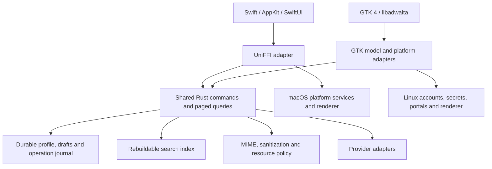

<!-- provenance: helper=codex model=gpt-6.1-sol started=2026-10-11T18:59:57+00:00 exit=0 brief=research/briefs/ -->

# Sweetbriar: a native Linux/Ubuntu front end on a shared Rust core

Research date: **2026-10-11**. Versions, maintenance status, packaging policies, and service availability are checked as of this date; dated announcements are identified separately. Recommendations and proposed acceptance targets are engineering judgments. No comparative performance benchmarks were run. User reports are individual observations, not representative surveys.

## 1. TL;DR

- **Recommend GTK 4 + libadwaita + gtk-rs for Ubuntu/GNOME.** Use native controls and desktop conventions; verify Yaru accents and appearance on actual Ubuntu installations and Flatpak runtimes. [GNOME styling guidance](https://developer.gnome.org/hig/guidelines/ui-styling.html), [Ubuntu Yaru](https://github.com/ubuntu/yaru)
- **Qt 6 + Kirigami + CXX-Qt is the strongest alternative**, especially if KDE becomes an equal priority. Qt also supplies useful rich-text editing infrastructure. [KDE application design](https://develop.kde.org/hig/kde_app_design/), [QTextEdit](https://doc.qt.io/qt-6/qtextedit.html)
- **100,000 messages are a data-model problem as well as a widget problem.** GTK and Qt virtualize views; Sweetbriar should provide paged queries, stable identities, bounded caches, and batched changes. [GTK scalable lists](https://blogs.gnome.org/gtk/2020/06/07/scalable-lists-in-gtk-4/), [Qt ListView](https://doc.qt.io/qt-6/qml-qtquick-listview.html)
- **Use WebKitGTK API 6.0 for GTK 4 HTML display**, with JavaScript disabled and a separate resource-loading policy. The checked engine release is WebKitGTK 2.54.1, released 2026-10-02; API 6.0 is not the engine version. [WebKitGTK releases](https://webkitgtk.org/news.html), [API reference](https://webkitgtk.org/reference/webkitgtk/stable/)
- **Share Rust behavior and storage, retain native presentation.** Share MIME, search, account backends, durable drafts, commands, and HTML policy; keep Swift/AppKit/SwiftUI and GTK adapters separate. UniFFI is a concrete Swift bridge. [UniFFI](https://mozilla.github.io/uniffi-rs/latest/)
- **Treat GOA, keyrings, portals, and background execution as optional platform capabilities.** GOA currently lists Microsoft 365 mail support, but its token API cannot request arbitrary scopes. Background permission does not promise uninterrupted execution. [GOA services](https://gnome.pages.gitlab.gnome.org/gnome-online-accounts/services.html), [GOA OAuth interface](https://gnome.pages.gitlab.gnome.org/gnome-online-accounts/dbus-org.gnome.OnlineAccounts.OAuth2Based.html), [Background portal](https://flatpak.github.io/xdg-desktop-portal/docs/doc-org.freedesktop.portal.Background.html)
- **Recommend Flatpak first, with a supported Ubuntu .deb path.** Add Snap after credential and background-service tests; make AppImage optional. Each package needs its own integration validation. [Flatpak permissions](https://docs.flatpak.org/en/latest/sandbox-permissions.html), [Snap credential interface](https://snapcraft.io/docs/reference/interfaces/password-manager-service-interface/)
- **Build data safety into the core now.** Acknowledge durable local saves separately from remote completion; preserve pending operations during repairs. Akonadi's own documentation warns that unsynced changes can reside in its database. [Akonadi](https://userbase.kde.org/Akonadi)
- **The macOS correction is verified:** Golden Gate 27 shipped 2026-09-14, supports Apple silicon Macs, and 27.0.1 shipped 2026-09-28. Its AppKit changes reinforce keeping platform presentation local. [Apple announcement](https://www.apple.com/newsroom/2026/09/major-updates-for-apples-software-platforms-are-now-available/), [compatibility](https://support.apple.com/en-ca/127255), [27.0.1](https://developer.apple.com/news/releases/?id=09282026c)

## 2. Findings

### 2.1 Toolkit choices and maturity

**Native means matching interaction conventions as well as colors.** My assessment is that GTK/libadwaita gives the best Ubuntu GNOME foundation, while Qt/Kirigami gives the best KDE foundation. KDE identifies Qt Widgets as suitable for complex traditional desktop applications and Kirigami as its adaptive Qt Quick framework. Ubuntu 26.04 LTS ships GNOME 50; installed Ubuntu libraries and current upstream releases are different baselines. [KDE design guidance](https://develop.kde.org/hig/kde_app_design/), [Ubuntu 26.04 release notes](https://documentation.ubuntu.com/release-notes/26.04/changes-since-previous-interim/)

**GTK/libadwaita maturity.** The checked upstream versions are GTK **4.24.1** and libadwaita **1.10.0**, the latter published 2026-09-14. Rust package versions are `gtk4` **0.11.5**, `libadwaita` **0.9.2**, `relm4` **0.11.0**, and `webkit6` **0.6.1**, checked 2026-10-11. Dependency records put this combination on gtk4 0.11/GLib 0.22. These independently versioned components must be pinned and tested together. [GTK API](https://docs.gtk.org/gtk4/), [libadwaita release archive](https://download.gnome.org/sources/libadwaita/1.10/), [gtk4 Rust API](https://docs.rs/gtk4/latest/gtk4/), [libadwaita Rust API](https://docs.rs/libadwaita/latest/libadwaita/), [Relm4 dependencies](https://crates.io/api/v1/crates/relm4/0.11.0/dependencies), [webkit6 dependencies](https://crates.io/api/v1/crates/webkit6/0.6.1/dependencies)

libadwaita provides its own appearance system; GNOME advises using its standard styles. Its accent-color support is documented from 1.6. Consequently, native GNOME behavior does not guarantee pixel-identical Yaru styling across a host installation and an independently supplied Flatpak runtime. Recommend following dark/light, accent, high-contrast, font, and reduced-motion preferences and testing actual Ubuntu combinations. Avoid maintaining a replacement theme inside Sweetbriar. [GNOME styling](https://developer.gnome.org/hig/guidelines/ui-styling.html), [accent support](https://gnome.pages.gitlab.gnome.org/libadwaita/doc/main/property.StyleManager.system-supports-accent-colors.html), [Yaru project](https://github.com/ubuntu/yaru)

Relm4 is an optional component architecture around GTK, rather than a replacement toolkit. Recommend it for bounded components such as account setup and preferences if it simplifies the team’s code. Keep the mailbox’s high-volume model adapter and the public core API independent of it. Its current dependencies include gtk4 and optional libadwaita integration. [Relm4 dependency record](https://crates.io/api/v1/crates/relm4/0.11.0/dependencies)

**Large lists.** `GtkListView` and `GtkColumnView` use models, selection models, and factories that instantiate/recycle visible widgets. `GListModel` provides synchronous item-count and item-access methods. This is suitable infrastructure for 100,000+ messages, but does not promise cheap sorting, database access, or materialization of every row object. [GTK scalable lists](https://blogs.gnome.org/gtk/2020/06/07/scalable-lists-in-gtk-4/), [GtkColumnView](https://docs.gtk.org/gtk4/class.ColumnView.html), [GListModel](https://gnome.pages.gitlab.gnome.org/gtk/gio/iface.ListModel.html)

Recommend a custom `GListModel` exposing lightweight cached summaries and placeholders while Rust fetches pages asynchronously. Never perform disk or network waits in `get_item`. Apply batched changes on GTK’s thread; preserve selection by stable message ID, and remove bindings when rows are recycled. Offer a compact `GtkColumnView` and a conversation-oriented `GtkListView` over the same query API. Sorting, filtering, and rank computation belong in the core. Test changing queries and arrivals during scrolling, rather than measuring a static list alone.

**Qt/CXX-Qt maturity.** Qt **6.12** shipped 2026-09-30; CXX-Qt **0.10.0** shipped 2026-08-24. CXX-Qt exposes Rust-backed QObject types to C++/QML, and its official example subclasses `QAbstractListModel` in Rust. It is therefore inaccurate to dismiss it as unable to implement models. Qt Quick `ListView` creates delegates for visible/cached items; `QAbstractItemModel` supplies incremental population through `fetchMore`, with model API calls confined to the owning GUI thread. [Qt announcement](https://www.qt.io/blog/qt-6.12-released), [CXX-Qt releases](https://github.com/KDAB/cxx-qt/releases), [Rust list-model example](https://github.com/KDAB/cxx-qt/blob/main/examples/todo_app/src/todo_list.rs), [Qt ListView](https://doc.qt.io/qt-6/qml-qtquick-listview.html), [Qt model API](https://doc.qt.io/qt-6/qabstractitemmodel.html)

For a KDE edition, recommend Kirigami/Qt Quick Controls and KDE conventions, or evaluate Qt Widgets for a dense traditional mail interface. CXX-Qt does not remove the need to integrate the remaining C++ Qt APIs. On Ubuntu GNOME, a carefully integrated Qt application can be good, but I would expect more work to match GNOME navigation and presentation. [Kirigami introduction](https://develop.kde.org/docs/getting-started/kirigami/), [CXX-Qt scope](https://github.com/KDAB/cxx-qt/blob/main/README.md)

**Rich composition is a decision gate.** `GtkTextView` supplies native input, text-buffer styling, undo/redo, and accessible text interfaces. Qt Widgets `QTextEdit` and Qt Quick `TextEdit` supply rich text through Qt’s document system, with supported HTML rather than an unrestricted browser editing surface. None supplies Sweetbriar’s MIME generation, draft durability, signature semantics, attachment handling, or arbitrary HTML round-tripping. [GtkTextView](https://docs.gtk.org/gtk4/class.TextView.html), [QTextEdit](https://doc.qt.io/qt-6/qtextedit.html), [Qt Quick TextEdit](https://doc.qt.io/qt-6/qml-qtquick-textedit.html)

Recommend a native editor for a defined email formatting subset: paragraphs, emphasis, links, lists, quotations, and inline images. Preserve imported draft content that cannot be edited faithfully. A browser composer may be necessary for more complex tables/layout, but should be a separately trusted document with a narrow bridge. Incoming HTML must never acquire scripting privileges because the composer needs them. This is an engineering trade-off; the available sources do not prove equivalent editing fidelity across these toolkits.

**HTML display.** WebKitGTK **2.54.1**, released **2026-10-02**, is the current checked engine. Its **API 6.0** is the GTK 4/libsoup 3 API, with pkg-config name `webkitgtk-6.0`; Rust’s corresponding package is `webkit6`. Qt WebEngine is the established Qt alternative. Both expose a JavaScript-disable setting. [WebKitGTK releases](https://webkitgtk.org/news.html), [WebKitGTK stable API](https://webkitgtk.org/reference/webkitgtk/stable/), [webkit6 settings](https://docs.rs/webkit6/latest/webkit6/struct.Settings.html), [Qt WebEngine settings](https://doc.qt.io/qt-6.8/qwebenginesettings.html)

For GTK, set `Settings::set_enable_javascript(false)` and `set_enable_javascript_markup(false)` before loading mail, and use an ephemeral `NetworkSession`. For Qt, set `QWebEngineSettings::JavascriptEnabled` false and use an isolated profile, request interceptor, and scheme handler. JavaScript settings alone do not govern every resource-loading path; Qt, for example, separately controls local-file and remote access. [WebKit settings](https://docs.rs/webkit6/latest/webkit6/struct.Settings.html), [ephemeral session](https://docs.rs/webkit6/latest/webkit6/struct.NetworkSession.html), [Qt settings](https://doc.qt.io/qt-6.8/qwebenginesettings.html), [Qt WebEngine overview](https://doc.qt.io/qt-6.8/qtwebengine-overview.html)

Recommend shared sanitization and a resource manifest: allow validated message-local `cid:` resources through a private scheme; block remote images, CSS resources, fonts, frames, and unsolicited navigation by default. Explicit remote-image permission should route approved requests through a controlled loader. Add CSP as defense in depth, isolate cookies/storage from OAuth, and open user-activated external links through the platform browser. WebKit supplies custom URI schemes and content filters, but the complete policy needs adversarial tests. Browser security updates remain necessary when scripting is disabled. [WebKit URI schemes](https://docs.rs/webkit6/latest/webkit6/struct.WebContext.html), [content filters](https://docs.rs/webkit6/latest/webkit6/struct.UserContentFilterStore.html), [security/release stream](https://webkitgtk.org/news.html)

**COSMIC/iced and Slint.** COSMIC Epoch 1 was released **2025-12-11**: describing it as merely an alpha in October 2026 would be stale. `libcosmic` is built around iced and targets COSMIC conventions; its current README still labels its accessibility feature experimental. Upstream `iced` is **0.14.0**, checked 2026-10-11. My assessment is that this is promising for a COSMIC front end, with more integration risk for a GNOME/KDE mail client. A production HTML-mail web-view integration meeting this brief was **(unverified)** in the material checked. [System76 release history](https://blog.system76.com/blog/post/cosmic-epoch-1-updates), [libcosmic](https://github.com/pop-os/libcosmic), [iced registry](https://crates.io/api/v1/crates/iced)

Slint’s checked stable package is **1.18.1**; its 1.18 announcement is dated **2026-09-16**. `ListView` virtualizes visible items, which addresses one requirement. However, the upstream embedded-web-view feature request remains open as checked 2026-10-11; a complete supported path for secure HTML mail plus rich composition is **(unverified)**. Native compilation alone does not establish GNOME or KDE interaction fidelity. I would postpone Slint for this application pending a successful integration prototype. [Slint release](https://www.slint.dev/blog/slint-1.18-released), [registry](https://crates.io/api/v1/crates/slint), [ListView](https://docs.slint.dev/latest/docs/slint/reference/std-widgets/views/listview/), [web-view request](https://github.com/slint-ui/slint/issues/3930)

**Other approaches.** Qt Widgets deserves consideration alongside QML, particularly for composition and dense tables. Tauri/Electron can share a web application shell, but that architecture conflicts with Sweetbriar’s native-control goal. Tauri’s current Linux AppImage instructions still identify the WebKitGTK 4.1 dependency; it is not a ready-made GTK 4 native front end. [KDE toolkit guidance](https://develop.kde.org/hig/kde_app_design/), [Tauri Linux distribution](https://v2.tauri.app/distribute/appimage/)

### 2.2 Lessons from existing mail clients

The following separates documented product characteristics from user observations. These are useful design inputs, not proof that one client is universally faster or safer.

| Client | Verified characteristics and reported strengths | Complaints or limitations; Sweetbriar lesson |
|---|---|---|
| **Geary** | Conversation-oriented GNOME client with search, styled composition, and GOA integration. Current source checked 2026-10-11 is Vala/C, GTK 3 and WebKit2GTK 4.1, despite its modern GNOME appearance. [Project overview](https://wiki.gnome.org/Apps/Geary), [build source](https://raw.githubusercontent.com/GNOME/geary/main/meson.build) | A discussion consulted 2026-10-11 praises simplicity while questioning maintenance. Treat that concern as sentiment, not proof the project is abandoned. Borrow conversational clarity while exposing dependable sync status and advanced controls. [User discussion](https://www.reddit.com/r/gnome/comments/1rpw1av/is_geary_still_being_maintained/) |
| **Evolution** | Documented search and mail organization, including virtual search folders, offer a useful power-user baseline. [Search documentation](https://help.gnome.org/evolution/mail-searching.html), [organization](https://help.gnome.org/evolution/mail-organizing.html) | A February–March 2025 report describes roughly 600,000 messages/600 folders, approximately 12-second search, and stalls when clearing it. A maintainer reports faster behavior on another large collection and requests reproduction details. Test cancellation, scope changes, and clearing results. [Report and response](https://discourse.gnome.org/t/evolution-clearing-search-high-cpu-usage/27346) |
| **KMail/Akonadi** | Akonadi separates applications from account/resources and caches local/remote PIM data; it also queues offline changes. [Akonadi architecture](https://userbase.kde.org/Akonadi) | A 2023 KDE discussion reports about 1 GiB use after account setup; this is an individual report. Index-rebuild problems also appear in a 2025 support thread. Make storage ownership, repair, and resource use understandable. [Resource complaint](https://discuss.kde.org/t/why-is-akonadi-so-heavy-are-there-any-plans-for-a-lighter-solution/2402), [index problem](https://discuss.kde.org/t/kmail-re-building-the-search-index-fails/28024) |
| **Thunderbird** | Its UI belongs to the Mozilla/Gecko codebase rather than a GTK 4 widget application. Its documented storage alternatives illustrate mature mail-storage requirements. [Codebase](https://developer.thunderbird.net/thunderbird-development/codebase-overview), [maildir documentation](https://support.mozilla.org/en-US/kb/maildir-thunderbird) | Mozilla still labels optional maildir experimental as checked 2026-10-11. Default mbox folder compaction and optional per-message files have different maintenance costs. Do not assume changing file format alone guarantees safety. [Compaction](https://support.mozilla.org/en-US/kb/compacting-folders), [maildir status](https://support.mozilla.org/en-US/kb/maildir-thunderbird) |
| **Mailspring** | Electron UI backed by a separate C++/MailCore2 sync engine, SQLite, and observable model updates: a concrete example of separating UI from mail machinery. [UI repository](https://github.com/Foundry376/Mailspring), [sync engine](https://github.com/Foundry376/Mailspring-Sync) | Its current offline guide limits offline availability to downloaded content, usually recent/opened mail. Cache availability is therefore different from archival completeness. Define and display Sweetbriar’s offline coverage. [Offline guide](https://www.getmailspring.com/docs/offline-account-access) |
| **Claws Mail** | Official features include MH storage, mbox import/export, filters/actions, templates, external editing, and automatic compose saving; its manual also documents keyboard shortcuts. [Features](https://www.claws-mail.org/features.php), [manual](https://www.claws-mail.org/manual/claws-mail-manual.html) | Its manual explicitly excludes HTML composition. Borrow the documented workflow depth, while evaluating modern rich editing independently. Readable message files are useful for recovery, but require correct durable writes. [Manual](https://www.claws-mail.org/manual/claws-mail-manual.html) |
| **Betterbird** | Thunderbird-derived; its published feature table emphasizes multiline views and expanded search. The checked stable release is **153.4.0esr-bb10, 2026-09-29**. [Project and features](https://www.betterbird.eu/) | Release notes document fixes involving draft text, searching status, and minimized CPU use. They also distinguish later builds not offered as updates; do not report those as shipped fixes. Use these failures as regression-test ideas. [Release notes](https://www.betterbird.eu/releasenotes/index.html) |

**What users value.** In a Mailspring discussion consulted 2026-10-11, participants praise its presentation and usability while others complain about battery use; the original poster criticizes Thunderbird’s resource use and Geary’s rendering. These are conflicting individual experiences, and proposed causes are not controlled measurements. Together with the Geary discussion, they suggest testing appearance, previews, keyboard efficiency, rendering fidelity, and idle power separately. [Mailspring discussion](https://www.reddit.com/r/linux/comments/1tfmgu5/mailspring_is_a_pretty_decent_email_client_and/), [Geary discussion](https://www.reddit.com/r/gnome/comments/1rpw1av/is_geary_still_being_maintained/)

An earlier Linux-client discussion, also consulted 2026-10-11, adds useful contrasts: contributors praise Claws for lean operation, Thunderbird for dependability and composition, and Evolution for search/account integration; others describe Evolution as cumbersome or choose Betterbird for perceived fixes. These historical experiences help identify valued workflows, but their old account/API assertions should not establish current compatibility. [Linux client user discussion](https://www.reddit.com/r/linux/comments/1ixz7v3/what_are_we_using_for_an_email_client_these_days/)

**Akonadi’s crucial data-safety distinction.** Its documentation describes the database as a cache but explicitly says offline changes can be pending there; deleting/recreating the database is safe only after those changes have synchronized. This establishes a concrete recovery hazard, without establishing a rate of corruption or message loss. Sweetbriar should label rebuildable search indexes, evictable downloaded replicas, local archives, drafts, and pending operations differently. Repair must never discard the latter categories. [Akonadi database guidance](https://userbase.kde.org/Akonadi)

Recommend carrying forward classic-client capabilities—saved searches, rules, templates, stationery, dense tables, keyboard actions, and genuine local archives—through the shared core. Progressive disclosure can keep the initial screen approachable without removing those capabilities. Claws’ feature list provides concrete precedent; choosing which to ship first is a Sweetbriar product decision. [Claws features](https://www.claws-mail.org/features.php)

### 2.3 Linux platform integration

**Accounts and OAuth.** The current GNOME Online Accounts service matrix lists mail for Google, Microsoft, Microsoft 365, and Microsoft Exchange. Older advice that Microsoft 365 integration only provides files is therefore stale. However, GOA’s `OAuth2Based.GetAccessToken` returns a token and lifetime without accepting arbitrary scope/audience arguments, and its documentation warns that refresh may take a long time. Availability of a GOA account is not proof that a token authorizes Sweetbriar’s chosen Gmail API or Graph operations. [GOA service matrix](https://gnome.pages.gitlab.gnome.org/gnome-online-accounts/services.html), [OAuth interface](https://gnome.pages.gitlab.gnome.org/gnome-online-accounts/dbus-org.gnome.OnlineAccounts.OAuth2Based.html)

Recommend a Linux account broker that discovers GOA accounts over D-Bus, respects the account’s enabled mail capability, and verifies provider/grant compatibility asynchronously. Keep Sweetbriar-owned account setup available on KDE and installations without GOA. Use the system browser and Authorization Code with PKCE where supported. RFC 8252 specifies external user agents for native applications; Google’s current installed-app documentation disallows embedded user-agent authorization and documents desktop loopback redirects. Do not authenticate inside the message-rendering web view. [GOA account interface](https://gnome.pages.gitlab.gnome.org/gnome-online-accounts/dbus-org.gnome.OnlineAccounts.Account.html), [RFC 8252, October 2017](https://www.rfc-editor.org/rfc/rfc8252), [Google native OAuth](https://developers.google.com/identity/protocols/oauth2/native-app)

**A material Microsoft change is happening now.** Microsoft’s Exchange Team notice, updated **2026-09-09**, says Exchange Online EWS default blocking begins **2026-10-01**, with temporary tenant-admin controls, and final shutdown **2027-04-01**. This does not retire on-premises Exchange Server EWS. Recommend Graph for a new Microsoft 365 backend; do not equate GOA’s Exchange-related entries with a future-proof protocol choice. [Microsoft retirement plan](https://techcommunity.microsoft.com/blog/exchange/exchange-online-ews-your-time-is-almost-up/4492361)

**Secrets.** `libsecret` is a client for the desktop Secret Service D-Bus API. Rust’s `secret-service` crate offers an asynchronous implementation; actual service availability and unlock behavior need testing on GNOME and KDE. The current `keyring` 4.2.0 documentation specifically directs applications selecting stores to `keyring-core` plus store crates, so old keyring 3.x feature recipes should not be copied unchanged. [libsecret](https://gnome.pages.gitlab.gnome.org/libsecret/), [Secret Service specification](https://specifications.freedesktop.org/secret-service/latest/), [Rust secret-service](https://docs.rs/secret-service/latest/secret_service/), [keyring guidance](https://docs.rs/keyring/latest/keyring/)

For a sandbox, the Secret portal retrieves an application-specific secret suitable for protecting an application’s encrypted credential vault. It is not a general API for browsing existing GOA/keyring credentials. Recommend a `SecretStore` abstraction with explicit locked, unavailable, denied, and missing states; store references in the core database, and make recovery/export semantics deliberate. A locked keyring must not trigger silent plaintext storage or deletion of accounts. [Secret portal](https://flatpak.github.io/xdg-desktop-portal/docs/doc-org.freedesktop.portal.Secret.html)

**Portals and notifications.** XDG portals provide desktop-mediated interfaces including notifications, opening a composer, and background/autostart permission. Rust’s `ashpd` wraps portal APIs using D-Bus. GTK’s `GApplication`/`GNotification` provide application identity, activation/actions, and notifications; choose a consistent platform adapter instead of exposing desktop APIs throughout Rust domain code. [ashpd](https://docs.rs/ashpd/latest/ashpd/), [Notification portal](https://flatpak.github.io/xdg-desktop-portal/docs/doc-org.freedesktop.portal.Notification.html), [GApplication](https://docs.gtk.org/gio/class.Application.html), [GNotification](https://docs.gtk.org/gio/class.Notification.html)

Recommend portal-backed attachment selection, imports, exports, and external URL opening. Copy selected attachments into durable draft storage before acknowledging that the draft contains them; retain owned content rather than only a reference to the selected file. FileChooser grants can persist across sessions, but do not supply Sweetbriar’s draft snapshot. Notifications should identify the account/message through opaque IDs, with configurable sender/subject previews and privacy defaults. Activation should open the existing application instance and select the message. [FileChooser portal](https://flatpak.github.io/xdg-desktop-portal/docs/doc-org.freedesktop.portal.FileChooser.html), [OpenURI portal](https://flatpak.github.io/xdg-desktop-portal/docs/doc-org.freedesktop.portal.OpenURI.html), [notification actions](https://flatpak.github.io/xdg-desktop-portal/docs/doc-org.freedesktop.portal.Notification.html)

**Background sync.** The Background portal can request permission to run after windows close and to autostart at login; the returned permission can be denied. Its contract is not a guarantee of execution through suspend, logout, resource pressure, or permission changes. Recommend distinguishing “background enabled,” “sync running,” and “last successful sync” in user-visible state. [Background portal](https://flatpak.github.io/xdg-desktop-portal/docs/doc-org.freedesktop.portal.Background.html)

For an unsandboxed package, an optional systemd user service is reasonable. `graphical-session.target` describes the graphical session; `PartOf=graphical-session.target` can stop a service with that session, while installation/activation needs separate configuration. `loginctl enable-linger` starts the user manager at boot and retains it after logout, but that is a separate policy choice—not a default Sweetbriar requirement. A lingering process may still lack an unlocked credential store or an interactive reauthentication route. Recommend no root mail daemon and no hidden enabling of linger. Flatpak should use its background mechanism rather than acquiring broad host access to install a systemd unit. [systemd session targets](https://www.freedesktop.org/software/systemd/man/latest/systemd.special.html), [linger semantics](https://www.freedesktop.org/software/systemd/man/latest/loginctl.html), [Flatpak permissions](https://docs.flatpak.org/en/latest/sandbox-permissions.html)

**Desktop search.** Tracker was renamed to TinySPARQL and LocalSearch in **July 2024**. LocalSearch documents a filesystem indexer/extractor and its SPARQL endpoint; it is not a replacement email-search engine. GNOME Shell’s `org.gnome.Shell.SearchProvider2` is the more direct integration point for returning application-owned search results and activating them. [Rename announcement, 2024-07-14](https://blogs.gnome.org/carlosg/2024/07/14/goodbye-tracker-hello-tinysparql-and-localsearch/), [LocalSearch overview](https://gnome.pages.gitlab.gnome.org/localsearch/overview.html), [search-provider guide](https://developer.gnome.org/documentation/tutorials/search-provider.html)

Recommend an optional search provider querying Sweetbriar’s existing Rust index. Keep its result count bounded and its privacy settings separate from in-app search. Avoid exporting all messages into a filesystem index merely to appear in Shell results. Search completeness, offline coverage, cancellation, and ranking must remain usable without any desktop search service.

**mailto and D-Bus.** Register a desktop file with `MimeType=x-scheme-handler/mailto;` and a suitable URI entry point, using D-Bus activation/application actions where appropriate. The Email portal opens the user’s default composer; it does not register Sweetbriar as that handler. Parse percent encoding, recipients, subject, and body according to RFC 6068, and present a reviewable draft; a URI must not silently cause sending. [Desktop Entry specification](https://specifications.freedesktop.org/desktop-entry-spec/latest/), [Email portal](https://flatpak.github.io/xdg-desktop-portal/docs/doc-org.freedesktop.portal.Email.html), [RFC 6068, October 2010](https://www.rfc-editor.org/rfc/rfc6068)

### 2.4 Distribution and sandboxing

**Flatpak/Flathub.** Flatpak’s sandbox provides private application storage, filtered session-bus access, and portal-mediated interactions. A mail client needs network access; granting it does not replace the renderer’s remote-content policy. Recommend a current maintained GNOME runtime, graphics/display access as needed, application-owned D-Bus names, and portals for attachments/import/export. Avoid whole-home access, unrestricted session-bus access, and host command execution. Direct GOA or Secret Service integration should request only the necessary service names and be reviewed separately. [Flatpak permissions](https://docs.flatpak.org/en/latest/sandbox-permissions.html)

Flathub’s current submission requirements favor current hosted runtimes and narrow permissions. Shipping a runtime does not remove responsibility for browser-engine updates, unsupported runtime transitions, or database migration recovery. Recommend Flatpak as the first broad Linux channel because it controls the GTK/WebKit combination; test desktop portal backends on both GNOME and KDE. [Flathub requirements, checked 2026-10-11](https://docs.flathub.org/docs/for-app-authors/requirements)

**Snap.** Strict confinement makes credentials and background behavior explicit integration work. As checked 2026-10-11, `password-manager-service` is **not auto-connected**; users need connection or an approved distribution policy. Snap’s experimental-feature reference, updated **2026-09-18**, still lists `user-daemons` as experimental and not enabled by default. Do not assume a native-package user-service design transfers unchanged. Test Secret portal support, login/background behavior, OAuth redirects, attachments, and refresh interruption before offering Snap as a primary channel. [Password-manager interface](https://snapcraft.io/docs/reference/interfaces/password-manager-service-interface/), [experimental features](https://snapcraft.io/docs/reference/development/experimental-features/)

**.deb.** This is the useful host-integrated Ubuntu path, especially for GOA and a systemd user service. The Ubuntu 24.04 base package pages list GTK **4.14.2** and libadwaita **1.5.0**; Ubuntu 26.04’s GTK base package is **4.22.2**, checked 2026-10-11. These are base-pocket versions, not assertions about every installed security/update revision. Recommend explicitly choosing supported Ubuntu releases and compiling feature flags against the oldest promised library baseline, or providing separate builds. A .deb installation does not itself establish Flatpak-style confinement. [24.04 GTK](https://packages.ubuntu.com/noble/libgtk-4-1), [24.04 libadwaita](https://packages.ubuntu.com/noble/libadwaita-1-0), [26.04 GTK](https://packages.ubuntu.com/resolute/libgtk-4-1)

**AppImage.** Its official guidance describes bundling an application and dependencies, building against an older supported environment, and optional update information. AppImageUpdate can be used with a separate sandbox such as Firejail; AppImage should not be treated as equivalent to an application sandbox. For a mail client, reliable engine updates and desktop registration matter more than producing a single downloadable file. Recommend AppImage only if a maintained portability/update pipeline is justified. [AppImage concepts](https://docs.appimage.org/introduction/concepts.html), [update information](https://docs.appimage.org/packaging-guide/optional/updates.html), [AppImageUpdate](https://appimage.github.io/AppImageUpdate/)

Across channels, recommend one documented logical profile format, exclusive writer locks, and explicit import/export. Do not have independently versioned package installations simultaneously mutate the same profile. Test migrations with an interrupted update and a downgrade attempt; package rollback alone must not be advertised as database rollback. Account tokens, encrypted backups, and private package storage need their own recovery story.

### 2.5 Shared code and the macOS boundary

**The correction is verified.** Apple released macOS 27 Golden Gate on **2026-09-14**; its compatibility page lists Apple silicon Macs. Apple's release listing records macOS **27.0.1 on 2026-09-28**. The supported design target should therefore be macOS 27 and 26, with availability checks around 27-only APIs. [Apple release announcement](https://www.apple.com/newsroom/2026/09/major-updates-for-apples-software-platforms-are-now-available/), [Golden Gate compatibility](https://support.apple.com/en-ca/127255), [macOS 27.0.1 release](https://developer.apple.com/news/releases/?id=09282026c)

Changes relevant to Sweetbriar include refined Liquid Glass contrast, toolbars and sidebars, plus a new relevance ranking in Apple's Mail search. These are reasons to keep macOS layout and presentation in Swift/AppKit/SwiftUI and to measure search quality against the current Mail product. Apple's Mail ranking is a product feature, not evidence of an API that Sweetbriar can reuse. [Apple's Golden Gate overview](https://www.apple.com/os/macos/)

The macOS 27 release notes add concrete UI changes: `NSRefreshController` integrates refresh with `NSScrollView`; `NSTextSelectionManager` provides gesture-based selection, also adopted by `NSTextView`; menu-image visibility changes with SDK linkage, with `NSMenuItem.preferredImageVisibility` for explicit control. Toolbar/segmented-control semantic roles can identify tabs to VoiceOver. Recommend implementing and testing these behaviors in the macOS adapter, with availability handling for 26. A shared Rust widget abstraction would make these platform improvements harder to adopt. [macOS 27 release notes](https://developer.apple.com/documentation/macos-release-notes/macos-27-release-notes)

**Share behavior, keep presentation local.** Recommended shared responsibilities are account capabilities, MIME interpretation, query semantics, result summaries, durable command state, drafts, sanitization policy, and provider adapters. Recommended per-platform responsibilities are controls, navigation, text input, accessibility, shortcuts, menus, window restoration, notifications, file pickers, secret storage, and rendering-engine configuration.

Use UniFFI for the Swift boundary and a direct Rust API for GTK. UniFFI officially supports Swift and generates bindings from Rust interface definitions; it does not package or distribute the Rust library for the application. Keep its records and object handles separate from GTK's GObjects and from Swift observation types. [UniFFI guide](https://mozilla.github.io/uniffi-rs/latest/)

For HTML policy, `ammonia` is a concrete candidate: it parses using `html5ever` and applies an allowlist. Its documentation describes web-page sanitization, not a complete email privacy policy. Sweetbriar must separately specify CSS, URLs, remote resource loading, CID references, and renderer behavior. [Ammonia documentation](https://docs.rs/ammonia/latest/ammonia/)

Share domain view models: message/thread summaries, available actions, saved searches, sync progress, account requirements, and draft revisions. Let Swift observation and GTK properties bind their own cached projections. Selection/focus, toolbar layout, undo interaction, input-method composition, and window geometry stay in platform presenters. No defensible percentage of shared UI code can be established before implementation; the useful boundary is responsibilities, not a promised reuse ratio.

**Localization.** Recommend a shared glossary, stable message IDs, translator context, and structured error parameters. Linux can use gettext catalogs via `gettext-rs`; macOS can use Xcode string catalogs. Alternatively, `fluent-bundle` supports shared Fluent messages where identical grammar is useful. Avoid forcing platform-specific menu prose into one catalog or sending preformatted English error strings over FFI. Date, time, number, plural, and shortcut presentation should follow local platform conventions. [gettext-rs](https://docs.rs/gettext-rs/latest/gettextrs/), [Fluent bundle](https://docs.rs/fluent-bundle/latest/fluent_bundle/), [Apple string catalogs](https://developer.apple.com/documentation/xcode/localizing-and-varying-text-with-a-string-catalog)

For composition, recommend a versioned draft representation with explicit text/rich-content semantics, original content preservation, attachment identities, and revision checkpoints. Define text-range encoding at the API boundary and test conversions rather than assuming Swift/native editor offsets equal Rust string byte offsets. Shared HTML sanitization should output content plus resource policy; per-platform WebKit/WebEngine adapters enforce that policy and render it. Neither a shared web view for the whole application nor a common custom control library is required for substantial core reuse.

### 2.6 The Rust core API to establish now

The following is a proposed Sweetbriar contract, not an existing crate API:

| Boundary | Required semantics |
|---|---|
| `open_profile` | Exclusive owner, schema compatibility, recoverable initialization; explicit errors for locked, full, or damaged storage. |
| `open_query(QuerySpec)` | Typed search/filter/sort; result generation, coverage, count status, and an opaque query handle. |
| `read_page(handle, range)` | Bounded summaries, deterministic ordering within a generation, cancellation, and no full-mailbox transfer. Support positional ranges for native scrolling alongside backend cursors. |
| `subscribe(handle, sequence)` | Batched insert/remove/update/reset events. Sequence gaps or overflow cause a resnapshot; callbacks never manipulate native widgets. |
| `message_content(id)` | MIME/body and attachment handles separately from list metadata; incremental/cancelable retrieval and offline-availability information. |
| `save_draft(id, expected_revision, edit)` | New revision plus a durable local acknowledgment; conflict handling and attachment ownership are explicit. |
| `execute(command, operation_id)` | Repeatable client request IDs; durable intent and separate local acceptance/remote progress/failure. |
| `account_capabilities(id)` | Provider features, authentication requirements, local/server search coverage, and unsupported operations without IMAP assumptions. |
| Platform services | Token/secret broker, file streams, external browser, lifecycle signals, and notifications supplied through adapters. |

**Identity must survive provider differences.** Gmail permits multiple labels per message; JMAP Email represents membership as `mailboxIds`. Recommend opaque internal `MessageId`, `ThreadId`, `MailboxId`, and `AccountId`, with provider mappings underneath. Do not make a folder-local IMAP UID, one-folder-per-message model, or filesystem pathname the universal identity. This keeps Gmail API, JMAP, Graph, IMAP, and local archives feasible without rewriting the UI. [Gmail labels](https://developers.google.com/gmail/api/guides/labels), [RFC 8621, August 2019](https://www.rfc-editor.org/rfc/rfc8621)

Proton Mail Bridge currently presents a local IMAP/SMTP server and runs as a separate desktop process. Treat that as a concrete backend option, and test loopback connectivity, TLS/credentials, and process availability in each Linux package. Support through an undocumented direct Proton API remains **(unverified)** here. [Proton Bridge, checked 2026-10-11](https://proton.me/mail/bridge)

**Execution and bindings.** Recommend a dedicated Rust async runtime, bounded CPU/blocking work, and page-sized crossings to Swift. `tokio` is a concrete runtime candidate; UniFFI supplies the Swift boundary, while GTK calls Rust directly. Keep GLib, QObject, SwiftUI, and native text objects outside the core. An abandoned view can cancel reads, but cannot cancel or erase an already committed durable user command. [Tokio](https://docs.rs/tokio/latest/tokio/), [UniFFI](https://mozilla.github.io/uniffi-rs/latest/)

**Storage and search.** Concrete candidates are `mail-parser` for MIME, `rusqlite` for SQLite metadata/transactions, and either SQLite FTS5 or `tantivy` for full-text indexing. SQLite FTS5 offers integrated SQL search; Tantivy is a separate Rust search engine. Their suitability for Sweetbriar’s ranking, multilingual tokenization, updates, and attachment coverage needs measurement. Keep the query contract independent of the index implementation and make index rebuild progress/coverage explicit. [mail-parser](https://docs.rs/mail-parser/latest/mail_parser/), [rusqlite](https://docs.rs/rusqlite/latest/rusqlite/), [FTS5](https://www.sqlite.org/fts5.html), [Tantivy](https://docs.rs/tantivy/latest/tantivy/)

Recommend original MIME blobs plus transactional metadata, versioned settings, durable drafts, and an operation journal. Separate local archives/pinned content from evictable server replicas. An acknowledged draft must survive process termination and the chosen power-loss model: in SQLite WAL mode, `synchronous=FULL` and `NORMAL` have different power-loss durability guarantees. Blob writes also need durable publication and recoverable coordination with metadata; setting a database pragma alone is insufficient. Test crashes, disk-full failures, interrupted migrations, and recovery from backups. [SQLite synchronous guarantees](https://www.sqlite.org/pragma.html#pragma_synchronous)

**Sending requires honest states.** SMTP can produce duplicate-delivery uncertainty after a timeout around the final data acknowledgment; local request deduplication cannot create universal exactly-once remote delivery. Recommend persisting the complete outgoing MIME and operation before transmission, then distinguishing queued, submission confirmed, sent-copy pending, and outcome unknown. A failure to archive a confirmed send must retry archival rather than resubmit the message. [RFC 5321, October 2008](https://www.rfc-editor.org/rfc/rfc5321)

**Process ownership.** Start with the core embedded in the macOS application and one writer per profile. Preserve a transport-neutral command/query boundary so Linux can later place the same core in an optional `sweetbriar-sync` process. If a service is used, it owns the database and the UI accesses it through an authenticated local channel; the UI must not open a second writable store. Avoid committing to a daemon, public RPC protocol, or multi-process framework before background requirements demand it.

## 3. Options compared

These fit/cost assessments are my judgment; capability statements refer to the documentation discussed above.

| Toolkit | Ubuntu GNOME/Yaru fit | KDE fit | Large-list path | Composition / HTML display | Assessment for Sweetbriar |
|---|---|---|---|---|---|
| **GTK 4 + libadwaita + gtk-rs** | Strong GNOME conventions; verify host/runtime accents | Functional GTK app, with distinct GNOME presentation | `GListModel` + `GtkListView`/`GtkColumnView` | Native `GtkTextView` plus mail editing work; WebKitGTK API 6.0 | **Preferred Ubuntu front end.** [GTK lists](https://blogs.gnome.org/gtk/2020/06/07/scalable-lists-in-gtk-4/), [text](https://docs.gtk.org/gtk4/class.TextView.html), [WebKit](https://webkitgtk.org/reference/webkitgtk/stable/) |
| **GTK 4 without libadwaita** | More appearance/layout work under application ownership | Still needs cross-desktop integration | Same GTK models/views | Same editor and WebKit path | Prototype only if libadwaita prevents a required workflow; do not assume omitting it automatically fixes Yaru fidelity. [GNOME styling guidance](https://developer.gnome.org/hig/guidelines/ui-styling.html) |
| **Qt 6/QML + Kirigami + CXX-Qt** | Requires deliberate GNOME integration | Strong KDE framework fit | Rust-backed `QAbstractListModel` and Qt Quick views | `TextEdit` rich text; Qt WebEngine | **Best competing choice if KDE is equal priority.** [Kirigami](https://develop.kde.org/docs/getting-started/kirigami/), [Rust model](https://github.com/KDAB/cxx-qt/blob/main/examples/todo_app/src/todo_list.rs) |
| **Qt Widgets + Rust bridge** | Conventional desktop interface; tune integration | KDE recommends it for complex traditional apps | Qt model/view infrastructure | `QTextEdit`; Qt WebEngine | Strong dense-mail/editor candidate; evaluate separately from QML. [KDE guidance](https://develop.kde.org/hig/kde_app_design/), [editor](https://doc.qt.io/qt-6/qtextedit.html) |
| **COSMIC/libcosmic/iced** | COSMIC presentation rather than GNOME conventions | Additional integration work | Needs a measured paged-list prototype | Complete required mail-editor/web-view path **(unverified)** | Keep available for a later COSMIC edition; accessibility remains a gate. [libcosmic](https://github.com/pop-os/libcosmic) |
| **Slint** | Application-specific UI; native feel must be designed | Application-specific UI | Virtualized `ListView` | Supported complete mail-editor/web-view path **(unverified)** | Defer pending web-view and accessibility/IME prototypes. [ListView](https://docs.slint.dev/latest/docs/slint/reference/std-widgets/views/listview/), [open web-view issue](https://github.com/slint-ui/slint/issues/3930) |
| **Tauri/Electron shell** | Web UI with platform integrations | Same architectural compromise | Web list virtualization is separate work | Browser editing/display | Sharing a whole shell undermines the stated native-control goal. [Tauri Linux requirements](https://v2.tauri.app/distribute/appimage/), [Mailspring example](https://github.com/Foundry376/Mailspring) |

| Distribution | Main benefit | Principal mail-client integration cost | Recommended role |
|---|---|---|---|
| **Flatpak/Flathub** | Controlled maintained runtime and portable sandboxed distribution | GOA/secret access, portal behavior, background permission, renderer updates | First broad Linux release. [Permissions](https://docs.flatpak.org/en/latest/sandbox-permissions.html), [submission requirements](https://docs.flathub.org/docs/for-app-authors/requirements) |
| **Snap** | Ubuntu-oriented channel with confinement | Credential interface connection and experimental user-daemon assumptions | Add after validated integration. [Credentials](https://snapcraft.io/docs/reference/interfaces/password-manager-service-interface/), [user-daemons](https://snapcraft.io/docs/reference/development/experimental-features/) |
| **.deb** | Direct Ubuntu library/service integration | Multiple library baselines and a maintained update channel | Supported host-integrated option. [24.04 baseline](https://packages.ubuntu.com/noble/libgtk-4-1), [26.04 baseline](https://packages.ubuntu.com/resolute/libgtk-4-1) |
| **AppImage** | Portable downloadable artifact | Optional updater, browser maintenance, desktop integration, external confinement | Optional after the first channels are dependable. [Concepts](https://docs.appimage.org/introduction/concepts.html), [updates](https://docs.appimage.org/packaging-guide/optional/updates.html) |

## 4. Recommendations and trade-offs

**Choose a GNOME-first Linux UI, while keeping the core ready for another native shell.** Use GTK 4, libadwaita, gtk-rs, WebKitGTK API 6.0, and optional Relm4 components. Keep the high-volume list adapter small and purpose-built. On macOS, keep Swift/AppKit/SwiftUI presentation and bridge to the same core with UniFFI. The reusable asset should be correct mail behavior and storage rather than identical screens.

**The strongest counter-argument is Qt.** Qt/Kirigami is the better KDE foundation and Qt’s rich-text document/editor infrastructure may reduce the hardest Linux UI work. A team already experienced in Qt, or a requirement for equally native KDE support at launch, could reasonably choose it instead. GTK’s advantage depends on Ubuntu/GNOME being the actual first Linux target; it does not establish a single universally native Linux interface. A short composer/list/web-view comparison should decide this before substantial Linux UI investment. [KDE framework guidance](https://develop.kde.org/hig/kde_app_design/), [Qt rich-text editor](https://doc.qt.io/qt-6/qtextedit.html)

**Establish the Rust boundaries during macOS development.** Separate account adapters, profile storage, search, MIME, draft operations, and platform services. Use typed errors and progress, opaque IDs, durable command acknowledgments, and paged observable queries. Avoid callbacks that require a particular UI event loop or a platform keychain in headless core tests. Bindings should expose useful batches and stream handles, not one FFI call per message field.

**Make local safety the foundation of optimistic UI.** A draft-save indicator should mean the local durable commit completed. A remote sync indicator should mean the server confirmed it. During disk-full or credential failures, preserve the last durable revision and clearly represent unsaved changes. Keep local archives and unsent mail protected from cache eviction. The trade-off is more explicit state, storage, and recovery code; the competing simpler “server is always the truth” design does not satisfy the project’s archive/draft goals.

**Use one HTML policy with native renderer adapters.** Start with `ammonia` as a parser/allowlist candidate, then define email-specific CSS and resource handling. The strongest objection to aggressive stripping is broken newsletter and quoted-message fidelity. Address that through a representative corpus, constrained style support, inspectable blocked-resource information, and explicit per-message permission—not silent unrestricted loading. [Ammonia’s documented scope](https://docs.rs/ammonia/latest/ammonia/)

**Ship Flatpak plus an intentional Ubuntu host-package path.** Supporting four formats immediately multiplies combinations of runtime, portals, credentials, and background lifecycle. Defer Snap/AppImage until those channels have a clear audience and verified behavior. The strongest objection is reach: some Ubuntu users prefer Snap or direct .deb installation. The .deb path mitigates that while the team proves confinement and background operation.

The proposed architecture is:

**Prototype gates before committing to the Linux toolkit:**

1. **Lists and search:** 100,000 messages, then 1 million; concurrent arrivals, deletion, sorting, cancellation, and clearing results. Measure time to first rows, p95 UI stalls, memory, and idle CPU. Proposed initial goals are cached first rows within 100 ms and no sustained scrolling stalls beyond a 16.7 ms frame budget on a documented 60 Hz reference machine. These are targets, not measured toolkit guarantees.
2. **Composition:** formatting subset, quotation nesting, pasted HTML, inline images, signatures, undo, spellchecking, right-to-left text, CJK input methods, screen-reader navigation, and two windows editing a draft. Force termination after acknowledged saves and recover the same content/attachments.
3. **HTML/privacy:** a corpus of ordinary and hostile messages; verify scripting remains disabled and all unsolicited network/file access is blocked, including CSS/font paths. Test links, CID images, printing, zoom, dark appearance, and assistive reading.
4. **Desktop/distribution:** GNOME/Yaru and KDE under Wayland; fallback display path if promised; Flatpak and .deb; locked/missing secrets; GOA and standalone OAuth; denied background permission; login/logout/suspend; package interruption; `mailto:` and notification activation.

Passing these gates justifies a toolkit commitment. Failure should reopen the specific decision—particularly native composition or packaging—without replacing the shared core architecture.

## 5. Risks and open questions

These are unresolved product/engineering decisions, not claims that the cited projects necessarily fail:

- **What does native Linux mean for the launch?** Choose Ubuntu/GNOME first or equal GNOME/KDE priority. Equal priority may justify Qt now, or a second native front end later; a themed generic shell will not by itself settle the interaction question.
- **What rich-text fidelity is required?** A defined native formatting subset is much cheaper to preserve than arbitrary imported HTML. Decide tables, stationery, signatures, and unsupported-format behavior before locking the editor.
- **What is the data-safety contract?** Specify acknowledgment boundaries, hardware/filesystem assumptions, archive retention, backup coverage, and recovery. SQLite durability settings have explicit power-loss trade-offs; an absolute promise against destroyed hardware needs recoverable copies outside that failure domain. [SQLite durability](https://www.sqlite.org/pragma.html#pragma_synchronous)
- **How complete is offline/search coverage?** Define which bodies/attachments are downloaded, indexed, encrypted, pinned, or server-only. Evaluate relevance and multilingual quality with a labeled corpus before selecting FTS5 or Tantivy. Report partial coverage visibly. [FTS5](https://www.sqlite.org/fts5.html), [Tantivy](https://docs.rs/tantivy/latest/tantivy/)
- **Which GOA grants actually work?** Validate Gmail API and Graph operations against real account types/tenant policies. GOA’s service matrix and token retrieval interface do not promise arbitrary scopes. [GOA services](https://gnome.pages.gitlab.gnome.org/gnome-online-accounts/services.html), [token interface](https://gnome.pages.gitlab.gnome.org/gnome-online-accounts/dbus-org.gnome.OnlineAccounts.OAuth2Based.html)
- **How should secrets and backups recover?** Decide whether an app-specific encrypted vault is portable, how recovery keys work, and what happens after keyring loss or package reinstallation. The Secret portal alone does not specify Sweetbriar’s account-recovery design. [Secret portal](https://flatpak.github.io/xdg-desktop-portal/docs/doc-org.freedesktop.portal.Secret.html)
- **What background promise is acceptable?** Windows closed, logged in, logged out, suspended, and credentials locked are different states. Portal permission and a service declaration require real lifecycle tests. Snap user-daemons remain documented as experimental as of 2026-10-11. [Background portal](https://flatpak.github.io/xdg-desktop-portal/docs/doc-org.freedesktop.portal.Background.html), [Snap status](https://snapcraft.io/docs/reference/development/experimental-features/)
- **Can the browser update pipeline remain prompt for years?** Track engine/runtime support for every package; avoid tying security fixes to a slow feature-release cadence. Disabling JavaScript does not eliminate the need for engine maintenance. [WebKitGTK updates](https://webkitgtk.org/news.html), [Qt WebEngine security patching](https://doc.qt.io/qt-6.8/qtwebengine-overview.html)
- **Will newer toolkits clear accessibility and integration gates?** COSMIC/libcosmic and Slint remain candidates, but the complete mail-editor/web-view path is **(unverified)** here. The reviewed libcosmic README labels accessibility experimental, and Slint’s web-view issue remains open. [libcosmic](https://github.com/pop-os/libcosmic), [Slint issue](https://github.com/slint-ui/slint/issues/3930)
- **What must “never lose settings” include?** Version durable account/rule/preferences data, test migrations, and retain recoverable previous state. Platform-only window geometry can be separate, but must not become the sole store for mail behavior or account configuration.

## 6. Sources consulted

All sources below were consulted for this report on **2026-10-11**, directly or through retrieved source/search content. Where the web fetcher failed, plain-HTTP requests were tried; several redirected successfully to HTTPS, including Claws, GTK, WebKitGTK, and systemd documentation. Apple’s release-note and string-catalog content was also retrieved through its Markdown endpoints. Forum reports remain anecdotal. Inline citations identify the source supporting each claim.

The bibliography below groups the cited URLs by topic.

### 6.1 Toolkits and desktop appearance

- [GNOME styling guidance](https://developer.gnome.org/hig/guidelines/ui-styling.html), [Ubuntu Yaru](https://github.com/ubuntu/yaru), [KDE application design](https://develop.kde.org/hig/kde_app_design/), [QTextEdit](https://doc.qt.io/qt-6/qtextedit.html).
- [GTK scalable lists](https://blogs.gnome.org/gtk/2020/06/07/scalable-lists-in-gtk-4/), [Qt ListView](https://doc.qt.io/qt-6/qml-qtquick-listview.html), [WebKitGTK releases](https://webkitgtk.org/news.html), [API reference](https://webkitgtk.org/reference/webkitgtk/stable/).
- [Ubuntu 26.04 release notes](https://documentation.ubuntu.com/release-notes/26.04/changes-since-previous-interim/), [GTK API](https://docs.gtk.org/gtk4/), [libadwaita release archive](https://download.gnome.org/sources/libadwaita/1.10/).
- [gtk4 Rust API](https://docs.rs/gtk4/latest/gtk4/), [libadwaita Rust API](https://docs.rs/libadwaita/latest/libadwaita/), [Relm4 dependencies](https://crates.io/api/v1/crates/relm4/0.11.0/dependencies), [webkit6 dependencies](https://crates.io/api/v1/crates/webkit6/0.6.1/dependencies).
- [accent support](https://gnome.pages.gitlab.gnome.org/libadwaita/doc/main/property.StyleManager.system-supports-accent-colors.html), [GtkColumnView](https://docs.gtk.org/gtk4/class.ColumnView.html), [GListModel](https://gnome.pages.gitlab.gnome.org/gtk/gio/iface.ListModel.html), [Qt announcement](https://www.qt.io/blog/qt-6.12-released).
- [CXX-Qt releases](https://github.com/KDAB/cxx-qt/releases), [CXX-Qt Rust model example](https://github.com/KDAB/cxx-qt/blob/main/examples/todo_app/src/todo_list.rs), [Qt model API](https://doc.qt.io/qt-6/qabstractitemmodel.html), [Kirigami introduction](https://develop.kde.org/docs/getting-started/kirigami/).
- [CXX-Qt scope](https://github.com/KDAB/cxx-qt/blob/main/README.md), [GtkTextView](https://docs.gtk.org/gtk4/class.TextView.html), [Qt Quick TextEdit](https://doc.qt.io/qt-6/qml-qtquick-textedit.html), [webkit6 settings](https://docs.rs/webkit6/latest/webkit6/struct.Settings.html).
- [Qt WebEngine settings](https://doc.qt.io/qt-6.8/qwebenginesettings.html), [ephemeral session](https://docs.rs/webkit6/latest/webkit6/struct.NetworkSession.html), [Qt WebEngine architecture/security](https://doc.qt.io/qt-6.8/qtwebengine-overview.html), [WebKit URI schemes](https://docs.rs/webkit6/latest/webkit6/struct.WebContext.html).
- [content filters](https://docs.rs/webkit6/latest/webkit6/struct.UserContentFilterStore.html), [System76 release history](https://blog.system76.com/blog/post/cosmic-epoch-1-updates), [libcosmic](https://github.com/pop-os/libcosmic), [iced registry](https://crates.io/api/v1/crates/iced).
- [Slint release](https://www.slint.dev/blog/slint-1.18-released), [Slint registry](https://crates.io/api/v1/crates/slint), [ListView](https://docs.slint.dev/latest/docs/slint/reference/std-widgets/views/listview/), [web-view request](https://github.com/slint-ui/slint/issues/3930).

### 6.2 Mail clients and user reports

- [Akonadi](https://userbase.kde.org/Akonadi), [Geary overview](https://wiki.gnome.org/Apps/Geary), [Geary build source](https://raw.githubusercontent.com/GNOME/geary/main/meson.build), [Geary user discussion](https://www.reddit.com/r/gnome/comments/1rpw1av/is_geary_still_being_maintained/).
- [Evolution search](https://help.gnome.org/evolution/mail-searching.html), [Evolution organization](https://help.gnome.org/evolution/mail-organizing.html), [Evolution performance discussion](https://discourse.gnome.org/t/evolution-clearing-search-high-cpu-usage/27346), [Akonadi resource discussion](https://discuss.kde.org/t/why-is-akonadi-so-heavy-are-there-any-plans-for-a-lighter-solution/2402).
- [KMail index discussion](https://discuss.kde.org/t/kmail-re-building-the-search-index-fails/28024), [Thunderbird codebase](https://developer.thunderbird.net/thunderbird-development/codebase-overview), [Thunderbird maildir status](https://support.mozilla.org/en-US/kb/maildir-thunderbird), [Mailspring UI](https://github.com/Foundry376/Mailspring).
- [Mailspring sync engine](https://github.com/Foundry376/Mailspring-Sync), [Mailspring offline coverage](https://www.getmailspring.com/docs/offline-account-access), [Claws features](https://www.claws-mail.org/features.php), [Claws manual](https://www.claws-mail.org/manual/claws-mail-manual.html).
- [Betterbird features/release](https://www.betterbird.eu/), [Betterbird release notes](https://www.betterbird.eu/releasenotes/index.html), [Mailspring user discussion](https://www.reddit.com/r/linux/comments/1tfmgu5/mailspring_is_a_pretty_decent_email_client_and/), [Thunderbird compaction](https://support.mozilla.org/en-US/kb/compacting-folders).
- [Linux client user discussion](https://www.reddit.com/r/linux/comments/1ixz7v3/what_are_we_using_for_an_email_client_these_days/).

### 6.3 Accounts, secrets, portals and desktop services

- [GOA services](https://gnome.pages.gitlab.gnome.org/gnome-online-accounts/services.html), [GOA OAuth interface](https://gnome.pages.gitlab.gnome.org/gnome-online-accounts/dbus-org.gnome.OnlineAccounts.OAuth2Based.html), [Background portal](https://flatpak.github.io/xdg-desktop-portal/docs/doc-org.freedesktop.portal.Background.html), [GOA account interface](https://gnome.pages.gitlab.gnome.org/gnome-online-accounts/dbus-org.gnome.OnlineAccounts.Account.html).
- [RFC 8252, October 2017](https://www.rfc-editor.org/rfc/rfc8252), [Google native OAuth](https://developers.google.com/identity/protocols/oauth2/native-app), [Microsoft retirement plan](https://techcommunity.microsoft.com/blog/exchange/exchange-online-ews-your-time-is-almost-up/4492361), [libsecret](https://gnome.pages.gitlab.gnome.org/libsecret/).
- [Secret Service specification](https://specifications.freedesktop.org/secret-service/latest/), [Rust secret-service](https://docs.rs/secret-service/latest/secret_service/), [keyring guidance](https://docs.rs/keyring/latest/keyring/), [Secret portal](https://flatpak.github.io/xdg-desktop-portal/docs/doc-org.freedesktop.portal.Secret.html).
- [ashpd](https://docs.rs/ashpd/latest/ashpd/), [Notification portal](https://flatpak.github.io/xdg-desktop-portal/docs/doc-org.freedesktop.portal.Notification.html), [GApplication](https://docs.gtk.org/gio/class.Application.html), [GNotification](https://docs.gtk.org/gio/class.Notification.html).
- [FileChooser portal](https://flatpak.github.io/xdg-desktop-portal/docs/doc-org.freedesktop.portal.FileChooser.html), [OpenURI portal](https://flatpak.github.io/xdg-desktop-portal/docs/doc-org.freedesktop.portal.OpenURI.html), [systemd session targets](https://www.freedesktop.org/software/systemd/man/latest/systemd.special.html), [linger semantics](https://www.freedesktop.org/software/systemd/man/latest/loginctl.html).
- [Rename announcement, 2024-07-14](https://blogs.gnome.org/carlosg/2024/07/14/goodbye-tracker-hello-tinysparql-and-localsearch/), [LocalSearch overview](https://gnome.pages.gitlab.gnome.org/localsearch/overview.html), [search-provider guide](https://developer.gnome.org/documentation/tutorials/search-provider.html), [Desktop Entry specification](https://specifications.freedesktop.org/desktop-entry-spec/latest/).
- [Email portal](https://flatpak.github.io/xdg-desktop-portal/docs/doc-org.freedesktop.portal.Email.html), [RFC 6068, October 2010](https://www.rfc-editor.org/rfc/rfc6068).

### 6.4 Distribution and Ubuntu baselines

- [Flatpak permissions](https://docs.flatpak.org/en/latest/sandbox-permissions.html), [Snap credential interface](https://snapcraft.io/docs/reference/interfaces/password-manager-service-interface/), [Tauri Linux distribution](https://v2.tauri.app/distribute/appimage/), [Flathub requirements, checked 2026-10-11](https://docs.flathub.org/docs/for-app-authors/requirements).
- [experimental features](https://snapcraft.io/docs/reference/development/experimental-features/), [24.04 GTK](https://packages.ubuntu.com/noble/libgtk-4-1), [24.04 libadwaita](https://packages.ubuntu.com/noble/libadwaita-1-0), [26.04 GTK](https://packages.ubuntu.com/resolute/libgtk-4-1).
- [AppImage concepts](https://docs.appimage.org/introduction/concepts.html), [update information](https://docs.appimage.org/packaging-guide/optional/updates.html), [AppImageUpdate](https://appimage.github.io/AppImageUpdate/).

### 6.5 macOS, bindings and localization

- [Apple September release announcement](https://www.apple.com/newsroom/2026/09/major-updates-for-apples-software-platforms-are-now-available/), [Golden Gate compatibility](https://support.apple.com/en-ca/127255), [macOS 27.0.1 release](https://developer.apple.com/news/releases/?id=09282026c), [Golden Gate product overview](https://www.apple.com/os/macos/).
- [macOS 27 release notes](https://developer.apple.com/documentation/macos-release-notes/macos-27-release-notes), [UniFFI](https://mozilla.github.io/uniffi-rs/latest/), [gettext-rs](https://docs.rs/gettext-rs/latest/gettextrs/), [Fluent bundle](https://docs.rs/fluent-bundle/latest/fluent_bundle/).
- [Apple string catalogs](https://developer.apple.com/documentation/xcode/localizing-and-varying-text-with-a-string-catalog).

### 6.6 Shared mail core and standards

- [Ammonia documentation](https://docs.rs/ammonia/latest/ammonia/), [Gmail labels](https://developers.google.com/gmail/api/guides/labels), [RFC 8621, August 2019](https://www.rfc-editor.org/rfc/rfc8621), [Proton Bridge, checked 2026-10-11](https://proton.me/mail/bridge).
- [Tokio](https://docs.rs/tokio/latest/tokio/), [mail-parser](https://docs.rs/mail-parser/latest/mail_parser/), [rusqlite](https://docs.rs/rusqlite/latest/rusqlite/), [FTS5](https://www.sqlite.org/fts5.html).
- [Tantivy](https://docs.rs/tantivy/latest/tantivy/), [SQLite synchronous guarantees](https://www.sqlite.org/pragma.html#pragma_synchronous), [RFC 5321, October 2008](https://www.rfc-editor.org/rfc/rfc5321).
