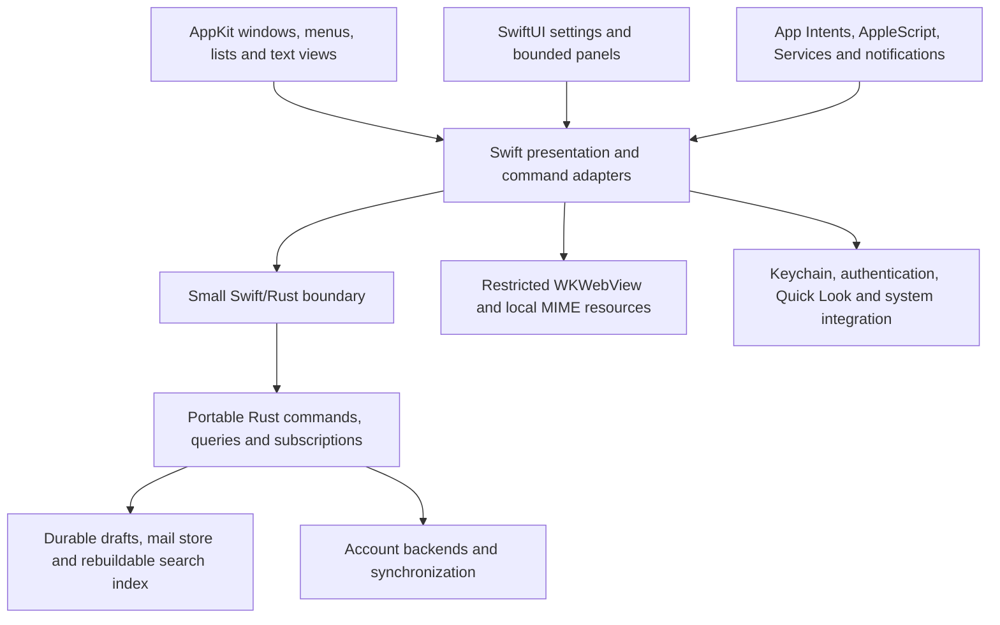

<!-- provenance: helper=codex model=gpt-6.1-sol started=2026-10-11T18:14:20+00:00 exit=0 brief=research/briefs/ -->

# Sweetbriar: a modern native macOS email UI

Research date: **2026-10-11**. Target: **macOS 26 Tahoe**, rather than an assumption that 26 is the newest OS. Apple released Tahoe on **2025-09-15**. All API availability, deprecation, library-status, product-distribution, and policy statements below are snapshots checked on **2026-10-11**; historical publication dates are identified where relevant. [Apple’s release announcement](https://www.apple.com/newsroom/2025/09/new-versions-of-apples-software-platforms-are-available-today/)

**Evidence boundary:** this is source research, not a benchmark or hands-on usability test. Apple’s performance figures and vendors’ speed claims are attributed to them. Sections labeled recommendations, proposed architecture, or acceptance targets express engineering judgment.

## 1. TL;DR

- **Recommend an AppKit application shell and interaction-heavy controls, with SwiftUI settings, inspectors, and small panels.** Apple explicitly supports mixing the frameworks, including SwiftUI scenes inside an AppKit lifecycle on macOS 26. [AppKit integration](https://developer.apple.com/documentation/swiftui/appkit-integration), [scene bridging](https://developer.apple.com/documentation/swiftui/nshostingscenerepresentation)
- **SwiftUI deserves a serious comparison prototype:** Apple’s WWDC25 figures report 6× faster loading and up to 16× faster updates for Mac lists above 100,000 items. They do not establish Sweetbriar’s performance. [WWDC25](https://developer.apple.com/videos/play/wwdc2025/256/)
- **Prefer a view-based `NSOutlineView` for the threaded message list**, with reusable AppKit cells and cached height calculations. AppKit has measured variable heights lazily near the viewport since Ventura. [WWDC22 AppKit](https://developer.apple.com/videos/play/wwdc2022/10074/)
- **Use WKWebView only for HTML message bodies**, with page JavaScript disabled, local MIME resources, compiled content rules, and an explicit remote-content policy. Plain text gets a selectable TextKit 2 view. [JavaScript control](https://developer.apple.com/documentation/webkit/wkwebpagepreferences/allowscontentjavascript), [content rules](https://developer.apple.com/documentation/webkit/wkcontentruleliststore), [TextKit](https://developer.apple.com/documentation/appkit/textkit)
- **Retire historical `WKProcessPool` tuning advice:** current Apple documentation marks it deprecated and says multiple pools no longer have an effect. [WKProcessPool](https://developer.apple.com/documentation/webkit/wkprocesspool)
- **Compose in NSTextView/TextKit 2**, supporting plain text first, restricted rich text, and optional Markdown. Keep the durable draft representation in Rust, with MIME serialization independent of the editor. [NSTextView](https://developer.apple.com/documentation/appkit/nstextview), [mail-builder](https://github.com/stalwartlabs/mail-builder)
- **Make power-user features native:** menus and configurable shortcuts, AppleScript, Services, App Intents, Quick Look, and notification actions should share one command layer. AppleScript reception remains possible in a sandboxed app. [Cocoa scripting](https://developer.apple.com/documentation/foundation/nsscriptsuiteregistry), [sandbox Apple events](https://developer.apple.com/library/archive/documentation/Miscellaneous/Reference/EntitlementKeyReference/Chapters/AppSandboxTemporaryExceptionEntitlements.html)
- **Start with Developer ID, notarization, and Sparkle**, while retaining a sandbox-compatible storage and extension design. Direct distribution and sandboxing can coexist. [Apple distribution](https://developer.apple.com/macos/distribution/), [Sparkle sandbox support](https://sparkle-project.org/documentation/sandboxing/)
- **Treat the Swift/Rust bridge as an early proof obligation:** UniFFI generates Swift bindings, but its current documentation still describes partial Swift 6 support and an open concurrency issue. [UniFFI Swift guide](https://mozilla.github.io/uniffi-rs/latest/swift/overview.html), [issue 2448](https://github.com/mozilla/uniffi-rs/issues/2448)

## 2. Findings

### 2.1 AppKit, SwiftUI, and macOS 26

**Verified capabilities.** SwiftUI on Tahoe is materially more capable than early Mac SwiftUI. Apple’s **WWDC25** presentation reports the large-list improvements above, improved update scheduling during scrolling, and a dedicated SwiftUI performance instrument. Those are relative improvements in Apple’s examples; the source does not provide an absolute latency guarantee for a threaded email list with complex cells. [What’s new in SwiftUI](https://developer.apple.com/videos/play/wwdc2025/256/)

Tahoe also adds rich-text `TextEditor` support through `AttributedString`; the release notes document a Mac Find Bar for TextEditor and fixes to its undo behavior. An assessment based on “SwiftUI can only edit plain text” would be stale. [Rich-text session, WWDC25](https://developer.apple.com/videos/play/wwdc2025/280/), [Tahoe release notes](https://developer.apple.com/documentation/macos-release-notes/macos-26-release-notes)

AppKit continues to receive the same design investment. Apple’s **WWDC25** AppKit session covers updated split views, toolbars, search, controls, scroll-edge effects, and `NSGlassEffectView`. Choosing AppKit does not force an older visual language. [Build an AppKit app with the new design](https://developer.apple.com/videos/play/wwdc2025/310/)

**Liquid Glass recommendation.** Use the system’s toolbar, sidebar, popover, and control treatments. Keep message bodies, compose text, and dense list content on stable, legible surfaces; avoid a glass effect around each message row. Test Reduce Transparency, Increase Contrast, inactive windows, and both appearances. This follows Apple’s distinction between navigation/control surfaces and content. [Adopting Liquid Glass](https://developer.apple.com/documentation/technologyoverviews/adopting-liquid-glass)

The strongest design counterpoint comes from actual maintenance experience. On **2026-09-22**, NetNewsWire author Brent Simmons wrote that adopting Liquid Glass had required substantial work despite its stock Mac UI, and argued for more custom presentation. That is his assessment, not a comparative maintenance study. Sweetbriar should borrow familiar behaviors without assuming every current visual treatment improves email density. [Simmons’s engineering commentary](https://inessential.com/2026/09/22/that-about-wraps-it-up-for.html)

**Performance problems to distinguish.** Apple’s profiling guidance identifies long view-body evaluations, excessive updates, dependency propagation, and complex layout as causes of hitches. A body that sorts, searches, decodes MIME, formats thousands of dates, or performs synchronous FFI calls remains expensive regardless of framework improvements. Use the SwiftUI instrument’s cause-and-effect graph, Time Profiler, and signposted core requests to locate work. [SwiftUI performance guidance](https://developer.apple.com/documentation/xcode/understanding-and-improving-swiftui-performance), [WWDC25 Instruments session](https://developer.apple.com/videos/play/wwdc2025/306/)

Observation tracks properties read while evaluating a view and invalidates dependent views when those properties change. It narrows dependencies; it does not turn a whole-mailbox array into a paged database query or make a computed sort cheap. **Recommendation:** use `@Observable` for small UI projections, expose row revisions and incremental changes, and keep caches outside observed state where appropriate. Do not treat Observation as a persistence or concurrency boundary. [Discover Observation, WWDC23](https://developer.apple.com/videos/play/wwdc2023/10149/)

`NSHostingView` participates in both SwiftUI layout and AppKit sizing. Its default `sizingOptions` includes minimum, intrinsic, and maximum size measurements; Apple explicitly says fewer options can improve performance when the containing layout already knows the size. There is no verified universal “milliseconds per hosting view” figure. **Recommendation:** start with coarse hosting boundaries. Recycled hosted cells remain a legitimate alternative to benchmark; do not instantiate a hosting hierarchy for every stored message. [NSHostingView](https://developer.apple.com/documentation/swiftui/nshostingview), [sizingOptions](https://developer.apple.com/documentation/swiftui/nshostingview/sizingoptions)

**Confirmed mixing examples.** Apple’s Shortcuts team explains its SwiftUI/AppKit integration, including hosted sidebar content, table cells, responder-chain participation, and focus. Mimestream’s public release notes explicitly identify SwiftUI template settings and a SwiftUI raw-source window, alongside a web-based conversation view. The precise implementation of Mimestream’s main message-list widget is **(unverified)**; its appearance is insufficient evidence. [Shortcuts engineering session, WWDC22](https://developer.apple.com/videos/play/wwdc2022/10075/), [Mimestream release notes](https://mimestream.com/releases)

**Recommended split:** AppKit owns window lifecycle, menus, toolbars, mailbox outline, message list, composer text, and responder behavior. SwiftUI owns bounded configuration and presentation surfaces. On a Tahoe-only baseline, `NSHostingSceneRepresentation` can host Settings or other SwiftUI scenes without replacing the AppKit lifecycle. [Scene bridging API](https://developer.apple.com/documentation/swiftui/nshostingscenerepresentation)

### 2.2 Message lists at 100,000+ rows

**Capabilities, not folklore.** `NSTableView` supports reusable view-based cells, multiple selection, per-row heights, and delegate customization of type selection. `NSOutlineView` adds hierarchy and disclosure while inheriting table behavior. Apple documents lazy row-view reuse and, from Ventura, lazy variable-height measurement. Neither API makes an expensive data source harmless. [Cell reuse](https://developer.apple.com/documentation/appkit/nstableview/makeview(withidentifier:owner:)), [selection](https://developer.apple.com/documentation/appkit/nstableview/allowsmultipleselection), [row heights](https://developer.apple.com/documentation/appkit/nstableviewdelegate/tableview(_:heightofrow:)), [NSOutlineView](https://developer.apple.com/documentation/appkit/nsoutlineview)

Apple explicitly says the Ventura height-measurement optimization also benefits SwiftUI List. It is not an exclusive AppKit advantage; the recommendation rests on control over interactions and updates. [WWDC22 AppKit explanation](https://developer.apple.com/videos/play/wwdc2022/10074/)

SwiftUI’s List and Table both support multiple selection. List supports hierarchical data, and `DisclosureTableRow`, available on macOS from **14.0**, supplies expandable Table rows. Current drag-container APIs include selection support. Claims that SwiftUI categorically cannot do threading, multiselection, or multiple-item dragging are incorrect. [List](https://developer.apple.com/documentation/swiftui/list), [Table](https://developer.apple.com/documentation/swiftui/table), [DisclosureTableRow](https://developer.apple.com/documentation/swiftui/disclosuretablerow), [input and drag APIs](https://developer.apple.com/documentation/swiftui/view-input-and-events)

| Requirement | AppKit table/outline | SwiftUI List/Table | Sweetbriar decision |
|---|---|---|---|
| Variable preview heights | Explicit height delegate or automatic Auto Layout heights | Layout-driven rows; behavior needs testing with the actual multiline design | Start with cached explicit AppKit heights |
| Thread disclosure | NSOutlineView’s hierarchy | Hierarchical List or DisclosureTableRow | Use one outline model for flat and threaded modes |
| Multiple selection | Row indexes; preserve logical IDs across updates | Selection binding to an ID set | Keep selection in an ID-based presentation model |
| Drag and drop | Data-source/delegate control and pasteboard integration | Transferable and drag/drop modifiers | Validate multi-message moves and Finder export separately |
| Type selection | Explicit matching-string and next-match delegates | Standard behavior plus customization requiring verification | Use AppKit’s documented hooks for sender/subject choice |
| Keyboard behavior | Responder chain and subclass hooks | Commands and focus APIs, with boundary coordination | Test range selection, disclosure keys, paging, and focus restoration |

The AppKit hooks and selection behaviors are documented in Apple’s table guide; the SwiftUI equivalents above come from its List, Table, and input API references. This table makes an implementation recommendation, not a measured speed ranking. [Table interactions](https://developer.apple.com/library/archive/documentation/Cocoa/Conceptual/TableView/RowSelection/RowSelection.html), [drag and drop](https://developer.apple.com/documentation/appkit/nstableviewdatasource/tableview(_:validatedrop:proposedrow:proposeddropoperation:))

**Proposed implementation.** Maintain an ordered, lightweight index of stable account-scoped message/thread IDs. Load display metadata in pages around the viewport; retain a bounded cache of sender, subject, date, flags, and snippet. Keep raw messages, attachments, and HTML out of row models. The Rust core performs filtering, sorting, threading, and search; Swift applies coalesced deltas on the main actor.

Use reused `NSTableCellView`/`NSTableRowView` instances. Cache heights by message revision, available width, font, and preview mode. Apple requires an efficient `heightOfRow` delegate and explicit height invalidation after changes; calls such as `reloadData()` invalidate the height cache. Avoid full reloads for a read flag or incoming-message badge. [Height delegate requirements](https://developer.apple.com/documentation/appkit/nstableviewdelegate/tableview(_:heightofrow:))

Keep thread expansion, anchor row, scroll offset, focus, and selection distinct. A sort or live search must preserve surviving selected IDs. Dragging exports `.eml` through promised files only when required; a move uses an explicit core command and reports its result. `NSFilePromiseProvider` supplies the native promised-file mechanism. [File promises](https://developer.apple.com/documentation/appkit/nsfilepromiseprovider)

**Acceptance targets, not existing measurements:** test 100,000 and 1,000,000 indexed messages, mixed preview heights, expanded long threads, 10,000 selected IDs, live sync, resizing, and VoiceOver. Target p95 keyboard selection feedback below 50 ms and no routine frame-budget overruns during warm scrolling: approximately 16.7 ms at 60 Hz or 8.3 ms at 120 Hz. Measure cold opening, sorting, retained memory, and jumps to distant rows separately. No consulted source proves either framework meets this complete workload.

### 2.3 Message viewing

**HTML path: WKWebView.** Use an application-owned configuration, with `defaultWebpagePreferences.allowsContentJavaScript = false`, and enforce the same policy for subsequent navigations. The older `WKPreferences.javaScriptEnabled` is deprecated. Apple’s current replacement disables scripts referenced by page content, including inline scripts and `javascript:` URLs. Keep app-injected scripts absent or narrowly audited; “page JavaScript off” is not a reason to trust a native script-message bridge. [Current preference](https://developer.apple.com/documentation/webkit/wkwebpagepreferences/allowscontentjavascript), [deprecated preference](https://developer.apple.com/documentation/webkit/wkpreferences/javascriptenabled)

Recommendation: cancel unexpected document navigation, open user-activated external HTTP(S) links in the default browser, and route `mailto:` links into editable drafts. Show link destinations clearly before activation.

Set `websiteDataStore` to `WKWebsiteDataStore.nonPersistent()`. It stores website data in memory instead of persisting it. **Recommendation:** separate mail-viewer state from account-login state, and use `ASWebAuthenticationSession` for supported OAuth flows. A nonpersistent store does not itself block requests, and may retain state in memory while alive. [Nonpersistent data](https://developer.apple.com/documentation/webkit/wkwebsitedatastore/nonpersistent()), [authentication session](https://developer.apple.com/documentation/authenticationservices/aswebauthenticationsession)

**Remote-content policy.** Compile a `WKContentRuleList` through `WKContentRuleListStore`, attach it to the configuration’s `WKUserContentController`, and finish that step before displaying mail. The public API filters resource loads using declarative rules. WebKit’s rule system can block loads, including different resource types; it is broader than an image-only preference. [Rule-list store](https://developer.apple.com/documentation/webkit/wkcontentruleliststore), [WebKit’s content-blocker explanation](https://webkit.org/blog/3476/content-blockers-first-look/)

Recommended defenses operate together:

1. Parse and sanitize HTML in Rust; remove executable content, forms, frames, embedded objects, refresh directives, and unauthorized URL schemes.
2. Default-block all network resource loads, covering HTTP and HTTPS images, stylesheets, CSS backgrounds, imports, fonts, media, and redirects. Install restrictive content-security policy as another layer; do not rely on navigation-delegate decisions to inspect every subresource.
3. Resolve authorized local MIME resources through an app-specific scheme. Strip or constrain SVG and other active resource formats.
4. Expose **Load remote content for this message** as an explicit action. Prefer an application-controlled fetch/cache path that rewrites allowed resources to local URLs, with redirect and size limits; do not turn JavaScript on when consent is given.
5. Fail closed if content-rule compilation or resource-policy setup fails. Test with a logging HTTP endpoint and adversarial mail fixtures to prove that displaying a blocked message emits no content requests.

These are a proposed security policy, not a claim that a default WKWebView configuration already provides it. `ammonia` is a concrete Rust sanitization candidate built on `html5ever`; its existence does not establish complete email-CSS compatibility or a zero-request guarantee. Audit URL-bearing attributes and allowed CSS independently. [Ammonia documentation](https://docs.rs/ammonia/latest/ammonia/), [sanitizer configuration](https://docs.rs/ammonia/latest/ammonia/struct.Builder.html)

**CID resources.** RFC 2392 defines `cid:` references to MIME body parts, and RFC 2387 defines multipart/related relationships. Resolve identifiers within the current message and MIME context, including percent-encoding and multipart alternatives; never use a global Content-ID lookup across accounts. [RFC 2392, August 1998](https://www.rfc-editor.org/rfc/rfc2392.html), [RFC 2387, August 1998](https://www.rfc-editor.org/rfc/rfc2387.html)

Register a `WKURLSchemeHandler` before creating the viewer, then rewrite CID references to an app-specific URL such as `sweetbriar-part://<message-token>/<part-token>`. Return only authorized part bytes with an accurate MIME type and handle cancellation. Apple prohibits taking over schemes WebKit already handles, such as HTTPS, and recommends app/company names in custom schemes. Using an app-specific scheme also avoids relying on undocumented `cid:` handling. [Scheme registration](https://developer.apple.com/documentation/webkit/wkwebviewconfiguration/seturlschemehandler(_:forurlscheme:))

**Reuse and prewarming.** Current documentation marks `WKProcessPool` deprecated and says creating multiple pools no longer has an effect; Safari 26’s WebKit notes also highlight that deprecation. Do not promise account isolation or a process-count limit through pools. [Apple API status](https://developer.apple.com/documentation/webkit/wkprocesspool), [Safari 26 release notes](https://webkit.org/blog/17333/webkit-features-in-safari-26-0/)

Recommendation: retain one active viewer per reading window and, only if measurement justifies it, one spare initialized with safe blank content. Never prewarm by loading unapproved remote mail resources. Cancel superseded loads and discard results whose message generation is stale. WebKit controls process allocation; hidden views are not guaranteed prewarming primitives. Handle `webViewWebContentProcessDidTerminate(_:)` by reconstituting the view from retained core data. [Termination callback](https://developer.apple.com/documentation/webkit/wknavigationdelegate/webviewwebcontentprocessdidterminate(_:))

**Dark mode.** WebKit does not automatically darken arbitrary documents. `color-scheme` and `prefers-color-scheme` enable cooperative dark styling. **Recommendation:** use semantic colors for Sweetbriar’s wrapper, preserve author-supported dark CSS where safe, and offer an original/light appearance toggle. A conservative reformatting mode may replace foreground/background colors in simple mail; universal inversion is inappropriate for photographs, logos, and intentional colors. [WebKit’s dark-mode explanation, 2019](https://webkit.org/blog/8840/dark-mode-support-in-webkit/)

**Printing, find, and selection.** WKWebView supplies `printOperation(with:)` returning `NSPrintOperation`, and `find(_:configuration:completionHandler:)` supports case sensitivity, direction, and wrapping. Build a native Find bar and distinguish **Find in Message** from mailbox search. Generate a print representation with app-controlled headers and print CSS, preserving the same remote-content policy. [Printing API](https://developer.apple.com/documentation/webkit/wkwebview/printoperation(with:)), [find API](https://developer.apple.com/documentation/webkit/wkwebview/find(_:configuration:completionhandler:))

Preserve browser text selection and standard Copy through the responder chain. Add a tested **Reply Quoting Selection** command. Extracting the current selection may require a small app-owned script or a Services/pasteboard path; choose and validate that implementation with page JavaScript disabled. The exact arbitrary-selection extraction design remains an open prototype question, not a reason to enable sender scripts. Apple describes Services-based selected-text exchange for custom views. [Services and Writing Tools integration](https://developer.apple.com/documentation/appkit/supporting-writing-tools-via-the-pasteboard)

**Plain-text fast path.** Render decoded text in a noneditable, selectable `NSTextView`, explicitly backed by `NSTextLayoutManager`/`NSTextContentStorage`, with link attributes and quote styling. TextKit 2 uses viewport-based layout; Apple warns against unnecessarily ensuring layout outside the viewport. This supports a native reader without an HTML conversion step, but its actual speed advantage must be measured. Preserve fixed text versus flowed paragraphs and show source on demand. [TextKit overview](https://developer.apple.com/documentation/appkit/textkit), [viewport guidance, WWDC21](https://developer.apple.com/videos/play/wwdc2021/10061/), [selectability](https://developer.apple.com/documentation/appkit/nstextview/isselectable)

### 2.4 Composing

**Recommended editor:** NSTextView with TextKit 2, inside a native compose window. NSTextView supplies rich text, attachments, input-method handling, selection, and key bindings; spell and grammar checking have explicit public properties. These are practical advantages for a Mac email editor, especially multilingual composition. [NSTextView](https://developer.apple.com/documentation/appkit/nstextview), [spell checking](https://developer.apple.com/documentation/appkit/nstextview/iscontinuousspellcheckingenabled), [grammar checking](https://developer.apple.com/documentation/appkit/nstextview/isgrammarcheckingenabled)

Use `NSTextView(usingTextLayoutManager: true)` or explicitly assemble the TextKit 2 stack. Audit legacy-layout access and observe compatibility-mode transitions; Apple provides `didSwitchToNSLayoutManagerNotification`. Tahoe also changes text-list-marker handling through `includesTextListMarkers`, so list serialization deserves an explicit regression fixture. [Initializer](https://developer.apple.com/documentation/appkit/nstextview/init(usingtextlayoutmanager:)), [compatibility transition](https://developer.apple.com/documentation/appkit/nstextview/didswitchtonslayoutmanagernotification), [Tahoe text changes](https://developer.apple.com/documentation/macos-release-notes/macos-26-release-notes)

| Compose mode | Proposed behavior | Trade-off |
|---|---|---|
| Plain text | Semantic paragraphs, selectable quote depth, optional format=flowed export | Best predictability; lacks rich visual emphasis |
| Restricted rich text | Bold, italic, links, lists, modest font choices, inline images; generate plain and HTML alternatives | Familiar editing; requires a tested document-to-MIME mapping |
| Markdown | Preserve Markdown source as the draft, preview generated HTML, explicit sending policy | Powerful for classic-client users; source and rendered text differ |

Markdown is an authoring option, not the universal format a recipient’s client expects. MailMate documents Markdown-integrated composing as a real power-user precedent. `pulldown-cmark` provides a CommonMark parser with optional extensions; sanitize its HTML output and decide explicitly whether the plain-text alternative contains source syntax or a readable projection. [MailMate](https://freron.com/), [pulldown-cmark](https://docs.rs/pulldown-cmark/latest/pulldown_cmark/)

**Format=flowed.** Implement RFC 3676 in the shared serializer and parser, not as a visual wrapping preference. A flowed line ends with a space before CRLF; `DelSp=yes` makes that space disappear when joining. Quote depth, space-stuffing for lines beginning with a space, `>`, or `From `, and the signature separator `-- ` require special treatment. Preserve explicit hard breaks, code, and fixed-format originals. Use compatible wrapping and fixtures for long URLs, international text, nested quoting, and trailing spaces; do not trim trailing whitespace indiscriminately. [RFC 3676, February 2004](https://www.rfc-editor.org/rfc/rfc3676.html)

**Rich text versus a web editor.** A web editor is worth considering if faithful editing of complex tables and arbitrary HTML is a product requirement. The cost is coordinating browser selection, JavaScript commands, native menus, paste, accessibility, undo, and a separately persisted document model. This is an architectural assessment, not a measured claim that all web editors are slower. For Sweetbriar’s initial scope, a restricted native editor makes the input and persistence contract easier to review. SwiftUI’s Tahoe rich-text editor is a credible third prototype, but its attachment, quoting, and command behavior still needs validation for this specific app. [SwiftUI rich text](https://developer.apple.com/videos/play/wwdc2025/280/)

**Writing Tools, checked 2026-10-11.** NSTextView and NSTextField have built-in support. AppKit allows choosing the interaction behavior, detecting the start/end of operations, and supplying ignored ranges. **Recommendation:** protect quoted correspondence and signatures, keep an ordinary Undo path, and coordinate draft-sync changes while an operation is active. Preserve the pre-operation draft revision; temporary generated text must not replace the only durable copy. Do not describe all Writing Tools operations as guaranteed on-device inference. [Writing Tools overview](https://developer.apple.com/documentation/appkit/writing-tools), [behavior and ignored ranges](https://developer.apple.com/documentation/appkit/customizing-writing-tools-behavior-for-system-views)

**Attachments and inline images.** Recommended behavior: copy imported bytes into the core’s immutable attachment store before calling a draft saved. A dropped file’s original path or a temporary `NSItemProvider` URL is not the durable attachment. Represent inline images with attachment IDs and generate `Content-ID` plus multipart/related at send time; ordinary attachments use multipart/mixed. `mail-builder` supports MIME generation; review its output against the relevant RFC fixtures instead of equating editor attachments with finished MIME. [MIME builder](https://github.com/stalwartlabs/mail-builder), [multipart/related](https://www.rfc-editor.org/rfc/rfc2387.html)

**Signatures, quoting, and safety.** Store signatures per sending identity, with plain and rich variants. Insert them through document operations so changing identity cannot silently duplicate or delete text. Keep quote blocks identifiable and editable, support selected-text replies, and make conversion between compose modes previewable and undoable. Use one core document model with explicit revisions; convert Swift’s text ranges deliberately at the Rust boundary. Native attributed strings are presentation objects, not the sole cross-platform draft archive.

Recommended state distinction: **Editing**, **Saved locally**, **Queued**, **Sending**, and **Sent/failed/uncertain**. “Saved” means a durable core acknowledgement, not that a SwiftUI binding changed. Autosave runs off the UI thread, but window closure and normal termination wait for pending persistence. On disk-full or core failure, retain the buffer, show the failure, and offer export. Forced termination before acknowledgement remains a risk to quantify in the crash-recovery prototype.

### 2.5 macOS integration

**Recommendation:** implement a single application-command layer with typed inputs, stable IDs, capability checks, durable results, and Undo where appropriate. Menus, shortcuts, scripts, notifications, and App Intents should call it. Incoming automation must not bypass account permissions or draft persistence.

| Integration | Verified native mechanism, checked 2026-10-11 | Proposed Sweetbriar behavior |
|---|---|---|
| App Intents / Shortcuts | `AppIntent`, `AppEntity`, `AppShortcutsProvider`; WWDC25 explicitly covers Spotlight actions on Mac. [Apple session](https://developer.apple.com/videos/play/wwdc2025/260/) | Search mail, open mailbox/message, create draft, attach files, apply tags. Make sending an explicit action with a clear result. |
| AppleScript | Cocoa scripting reads an `.sdef`; bundle keys include `NSAppleScriptEnabled` and `OSAScriptingDefinition`. [Registry](https://developer.apple.com/documentation/foundation/nsscriptsuiteregistry), [bundle key](https://developer.apple.com/documentation/bundleresources/information-property-list/osascriptingdefinition) | Expose accounts, mailboxes, messages, drafts, selection, and explicit commands through Objective-C-compatible adapters. Preserve identifiers across launches. |
| Services | `NSServices` declares menu entries, selector, accepted types, and returned types. [Info.plist definition](https://developer.apple.com/documentation/bundleresources/information-property-list/nsservices) | Compose with selected text/files, send a selection to a draft, and expose relevant text to other apps’ Services. |
| Spotlight | `CSSearchableItem`, attribute sets, and `CSSearchableIndex` index private on-device content. [Indexing guide](https://developer.apple.com/documentation/corespotlight/adding-your-app-s-content-to-spotlight-indexes) | Opt-in account/content scopes, stable IDs, deletion on removal, deep links to results. Keep the portable Rust search index authoritative. |
| Quick Look | `QLPreviewPanel`/`QLPreviewView` are the Mac APIs; the shared panel follows the responder chain. [Quick Look UI](https://developer.apple.com/documentation/quicklookui), [panel](https://developer.apple.com/documentation/quicklookui/qlpreviewpanel) | Space-bar attachment preview, bounded cache files, safe filenames, and a later custom `.eml` preview extension. |
| Share extension | macOS supports the `com.apple.share-services` extension point and a shared-container design. [Share guide](https://developer.apple.com/library/archive/documentation/General/Conceptual/ExtensibilityPG/Share.html), [shared containers](https://developer.apple.com/library/archive/documentation/General/Conceptual/ExtensibilityPG/ExtensionScenarios.html) | Import text, URLs, and attachments into a durable draft before completing the extension request; coordinate storage ownership with the main app. |
| Notifications | `UNNotificationCategory`, `UNNotificationAction`, and `UNTextInputNotificationAction` provide actions and typed replies. [Categories/actions](https://developer.apple.com/documentation/usernotifications/declaring-your-actionable-notification-types), [text input](https://developer.apple.com/documentation/usernotifications/untextinputnotificationaction) | Open, archive, mark read, and reply. Route actions through durable commands; offer private previews and avoid exposing mail bodies by default. |
| Focus filters | `SetFocusFilterIntent` is available on macOS from **13.0**. [API](https://developer.apple.com/documentation/appintents/setfocusfilterintent) | Filter visible accounts and notification policy, while maintaining normal storage and sync. Restore the previous presentation when Focus ends. |
| Handoff | `NSUserActivity`, declared activity types, and optional continuation streams transfer resumable activity. [Handoff guide](https://developer.apple.com/documentation/foundation/continuing-user-activities-with-handoff) | Resume a message or saved draft using opaque IDs and revisions. Defer until another Sweetbriar endpoint can resolve the activity and its data. |
| Default mail client | Register `mailto` through `CFBundleURLTypes`; `NSWorkspace.setDefaultApplication(at:toOpenURLsWithScheme:completion:)` asks for consent where required. [Registration](https://developer.apple.com/documentation/bundleresources/information-property-list/cfbundleurltypes), [default handler API](https://developer.apple.com/documentation/appkit/nsworkspace/setdefaultapplication(at:toopenurlswithscheme:completion:)) | User-initiated Make Default; parse links into editable drafts and never send automatically. Verify the sandboxed path and provide manual-selection instructions. |
| Menu bar extra | `MenuBarExtra` is a SwiftUI scene; AppKit lifecycle apps can host scenes on 26. [MenuBarExtra](https://developer.apple.com/documentation/swiftui/menubarextra), [bridging](https://developer.apple.com/documentation/swiftui/nshostingscenerepresentation) | Optional unread indicator and quick compose. Keep background-sync lifecycle separate from the extra’s visibility. |
| Shortcut customization | macOS supports user overrides for menu commands through App Shortcuts. [Apple Support](https://support.apple.com/guide/mac-help/create-keyboard-shortcuts-for-apps-mchlp2271/mac) | Standard menu key equivalents plus a shortcut recorder for advanced bindings; detect conflicts and provide Reset. Single-letter triage keys only when focus is outside editable text. |

For AppleScript commands that require asynchronous core work, `NSScriptCommand.suspendExecution()` and `resumeExecution(withResult:)` allow suspending a script reply. Use bounded queries rather than materializing every message object, and report errors consistently. [Suspending commands](https://developer.apple.com/documentation/foundation/nsscriptcommand/suspendexecution()), [resuming commands](https://developer.apple.com/documentation/foundation/nsscriptcommand/resumeexecution(withresult:))

For `mailto:`, follow RFC 6068’s escaping and header rules. Treat all supplied values as draft input, bound their size, and reject header injection; arbitrary attachments are not a standard `mailto` facility. [RFC 6068, October 2010](https://www.rfc-editor.org/rfc/rfc6068.html)

Apple’s manual default-email instructions, published **2025-12-23** and checked **2026-10-11**, use **Mail → Settings → General → Default email reader**. Do not confuse this with the default-browser control in System Settings. [Apple’s default-app instructions](https://support.apple.com/en-au/102362)

**Accessibility is part of the control contract.** Standard AppKit controls implement accessibility behavior, but custom cells need meaningful roles, values, actions, and change notifications. Label sender, subject, unread/flag state, thread disclosure, and attachment actions; maintain sensible reading order and keyboard focus. SwiftUI/AppKit wrappers also need correct accessible labels. Test VoiceOver, keyboard-only use, high contrast, increased text size, and rapid sync while a row is being read. [Method-based AppKit accessibility](https://developer.apple.com/documentation/appkit/nsaccessibilityprotocol), [SwiftUI accessibility fundamentals](https://developer.apple.com/documentation/swiftui/accessibility-fundamentals)

**Localization.** Use `.xcstrings` catalogs, plural rules, locale-aware dates/numbers, and translator comments. Test right-to-left layouts, mixed-direction addresses, emoji, input methods, and long translated menu titles. Keep portable core errors as structured codes/parameters so each native UI localizes them. Xcode supports extracting localizable strings and managing plural/device variants in catalogs. [String catalogs](https://developer.apple.com/documentation/xcode/localizing-and-varying-text-with-a-string-catalog)

**Foundation Models, checked 2026-10-11.** The framework’s `SystemLanguageModel` is an on-device text model introduced on macOS **26.0**. Check `availability` and `supportsLocale(_:)`; not every Mac, region, configuration, or language qualifies. Apple documents a **4,096-token** context for the on-device model and exposes `contextSize` in current SDK documentation. Long correspondence must be chunked or rejected gracefully rather than silently truncated. [System model](https://developer.apple.com/documentation/foundationmodels/systemlanguagemodel), [context management](https://developer.apple.com/documentation/foundationmodels/managing-the-context-window), [locale support](https://developer.apple.com/documentation/foundationmodels/supporting-languages-and-locales-with-foundation-models)

Apple’s **February 2026** update notes specifically describe a changed model with macOS 26.4 and recommend re-testing prompts. Current documentation also describes newer 27-era capabilities; do not assume those APIs exist on the target’s 26 baseline. [Framework update history](https://developer.apple.com/documentation/updates/foundationmodels)

Recommendation: optional, user-invoked summarization and rewriting of selected local content, cancellable and visibly fallible. Keep deterministic search, synchronization, and rules independent of model availability. Treat message text as untrusted input, give summarization no mail-mutating tools, and preserve originals and Undo. Any cloud-backed alternative needs a separately disclosed data path. The strongest case against integrating this initially is the validation burden: ordinary mail reliability has much higher priority than generated convenience.

### 2.6 Distribution

**Policy snapshot: 2026-10-11.** App Sandbox is required for Mac App Store distribution. It limits filesystem and resource access, but permits container storage and additional access through appropriate entitlements and user selections. A large local mail archive is not intrinsically incompatible with sandboxing. [App Sandbox](https://developer.apple.com/documentation/security/app_sandbox), [file access](https://developer.apple.com/documentation/security/accessing-files-from-the-macos-app-sandbox)

| Concern | Mac App Store | Developer ID + notarization |
|---|---|---|
| Mail storage / export | Container or App Group; user-selected imports/exports and persistent security-scoped bookmarks | More location flexibility; sandbox remains optional and useful |
| AppleScript reception | Allowed by the sandbox; sending events to other apps needs additional treatment | Receiving remains straightforward; outgoing automation still encounters entitlement/privacy controls |
| Downloaded executable plug-ins | App Review restricts downloaded code that adds or changes functionality | Possible within signing, runtime, and security constraints; still a major attack surface |
| Background/login agents | User consent required, including processes that continue after Quit | Use the same visible consent and modern Service Management APIs |
| Updates | Store updates required; an independent updater is disallowed | Sparkle, an owned appcast, signed artifacts, and notarized releases |
| Commercial operation | Store review and applicable purchase policies | Own licensing, billing, support, and distribution operations |

The Store-specific restrictions above come from **2.4.5**, including startup/post-Quit consent, downloaded functionality, and update distribution. They do not amount to a blanket prohibition on every helper or automation feature. [App Review Guidelines](https://developer.apple.com/app-store/review/guidelines/)

Sandboxed applications can receive Apple events, respond to them, and send events to themselves. Outgoing cross-app events use scripting-target entitlements or exceptions; hardened-runtime automation also has an Apple-events entitlement. User-supplied scripts have a specialized `NSUserAppleScriptTask` path, with directory and write restrictions. These mechanisms exist, but approval of a particular extension design should not be assumed. [Sandbox event rules](https://developer.apple.com/library/archive/documentation/Miscellaneous/Reference/EntitlementKeyReference/Chapters/AppSandboxTemporaryExceptionEntitlements.html), [automation entitlement](https://developer.apple.com/documentation/bundleresources/entitlements/com.apple.security.automation.apple-events), [user-script tasks](https://developer.apple.com/documentation/foundation/nsuserapplescripttask)

On modern macOS, `SMAppService` manages bundled login items, launch agents, and daemons. **Recommendation:** begin with in-app synchronization, then add an opt-in bundled login helper only if post-Quit mail checking is a real requirement. Keep one owner of sync and storage; a menu bar extra is not that owner. [Service Management](https://developer.apple.com/documentation/servicemanagement/smappservice)

Direct distribution requires an operational release pipeline. Apple’s notarization workflow uses `notarytool` or the Notary API; uploads through `altool` stopped being accepted on **2023-11-01**. Sign embedded executables, enable the required hardened runtime, inspect notarization logs, staple tickets, and test a downloaded release. Sparkle recommends HTTPS and Ed25519-signed update artifacts. Sandboxed direct apps can use Sparkle’s documented helper/XPC setup. [Notarization](https://developer.apple.com/documentation/security/notarizing-macos-software-before-distribution), [Sparkle](https://sparkle-project.org/documentation/), [sandboxed updater](https://sparkle-project.org/documentation/sandboxing/)

Direct distribution does not remove plug-in signing constraints: hardened-runtime library validation normally restricts loaded code to Apple or the app’s own Team ID. Disabling validation permits additional plug-ins but removes a protection. **Recommendation:** expose commands and user automation first; postpone third-party native code loaded into the mail process. [Library validation](https://developer.apple.com/documentation/bundleresources/entitlements/com.apple.security.cs.disable-library-validation)

**Actual products, checked 2026-10-11:**

| Client | Verified distribution evidence | Implication |
|---|---|---|
| Mimestream | Official direct download; vendor documents Developer ID signing, notarized updates, sandboxing, and a limited unsandboxed helper. [Download](https://mimestream.com/download), [security model](https://mimestream.com/trust/security-and-privacy) | Direct distribution can coexist with a predominantly sandboxed native app. |
| MailMate | Current website offers direct downloads and an internal update channel. Its **2012-11-09** announcement explains Store withdrawal because it was not sandboxed. [Current downloads](https://freron.com/download/), [historical decision](https://blog.freron.com/2012/mailmate-1-5-released/) | Powerful scripting/customization has historically favored direct distribution. Do not mistake the old announcement for a complete audit of today’s build. |
| Spark | Current vendor instructions offer both website and Mac App Store versions. [Download instructions](https://sparkmailapp.com/help/general/how-to-download-spark) | Dual-channel distribution is feasible, with ongoing packaging and validation costs. |
| Airmail | Current official FAQ says macOS purchases are exclusively through the Mac App Store; betas use TestFlight. [FAQ](https://help.airmailapp.com/en-us/article/faq-1j9ztiz/) | The Store can support a substantial email client. |

Mimestream’s verified direct channel is sufficient for this comparison; exclusive absence from every Store region is **(unverified)**. Vendor pages do not establish Spark or Airmail’s internal UI toolkit or the exact entitlements of their current binaries.

### 2.7 Native apps to study

These are design-study recommendations, with verified public features distinguished from subjective lessons. No independent comparative performance measurements were performed.

| App | Public evidence | What Sweetbriar should study |
|---|---|---|
| Things | Extensive keyboard commands, configurable Quick Entry, and an OS 26 redesign described on **2025-09-15**. [Keyboard guide](https://culturedcode.com/things/support/articles/2785159/), [OS 26 changes](https://culturedcode.com/things/blog/2025/09/things-for-os-26/) | Fast capture, clear focus, direct keyboard manipulation, restrained appearance, and informative empty states. |
| NetNewsWire | Open source; the current Mac timeline subclasses NSTableView, the sidebar subclasses NSOutlineView, and article display subclasses WKWebView. [Timeline](https://github.com/Ranchero-Software/NetNewsWire/blob/main/Mac/MainWindow/Timeline/TimelineTableView.swift), [sidebar](https://github.com/Ranchero-Software/NetNewsWire/blob/main/Mac/MainWindow/Sidebar/SidebarOutlineView.swift), [viewer](https://github.com/Ranchero-Software/NetNewsWire/blob/main/Mac/MainWindow/Detail/DetailWebView.swift) | Closest inspectable architecture: list/detail navigation, responder behavior, keyboard handling, and modest row views. It is an RSS reader, not proof of email correctness or 100k-row throughput. |
| Nova | Panic describes a Mac-native editor, with integrated search, workflows, and extensions. [Product](https://nova.app/) | Dense productivity layout, native editor commands, discoverable panels, and customization that preserves the main workflow. Internal toolkit details are **(unverified)**. |
| Tower | The CTO’s **March 2021** engineering interview explains separate native Mac/Windows implementations and system-framework integration. [Engineering interview](https://www.git-tower.com/blog/developing-for-the-desktop-tower/) | Clear stateful operations, keyboard-driven navigation, drag/drop, and contextual actions. Its historical language choices do not establish the current implementation. |
| Ivory | Tapbots emphasizes scrolling and timeline-position retention across devices. Those are vendor claims. [Product](https://tapbots.com/ivory/) | Preserve reading position while new items arrive, keep row actions predictable, and avoid unnecessary list movement. Do not infer its implementation from its appearance. |
| Mimestream | Native Gmail-oriented client with keyboard shortcuts, multiple windows, profiles/Focus behavior, menu bar integration, and documented mixed rendering components. [Product](https://mimestream.com/), [release notes](https://mimestream.com/releases) | The strongest direct product comparison for triage, compose windows, account separation, and Gmail-specific capabilities. Extend the lesson through a provider-neutral command/capability model. |

My assessment of “native and fast” is behavioral: immediate keyboard feedback, retained selection and scroll position, correct menus/Undo, predictable window restoration, complete text interaction, and a stable interface during background work. These are acceptance criteria to test, not properties automatically conferred by AppKit or SwiftUI.

### 2.8 Proposed stack and app structure

**Recommended ownership:** the Rust core owns persisted mail, drafts, settings, sync, MIME, search, and command semantics. Swift owns Mac presentation and platform services. Avoid a second authoritative mail database in SwiftData/Core Data; doing so would create an unnecessary reconciliation problem for the Linux core.

The diagram is a proposed architecture, not an implementation claim.

| Component | Concrete starting choice | Boundary |
|---|---|---|
| Application | Swift AppKit: NSApplicationDelegate, NSWindowController, NSSplitViewController, NSToolbar | Mac lifecycle and command routing |
| Mailboxes / threads | NSOutlineView, reused native cells | Lightweight IDs and row metadata |
| Settings / inspectors | SwiftUI, Observation, NSHostingController; 26 scene bridging where useful | Small UI projections |
| Reader | WKWebView for sanitized HTML; NSTextView/TextKit 2 for plain text | Immutable body/part handles |
| Composer | NSTextView/TextKit 2, native recipient/attachment controls | Revisioned portable draft document |
| Swift/Rust bridge | Evaluate UniFFI first; retain a small C ABI fallback | Bounded results, explicit errors, cancellation and ownership |
| MIME | Evaluate `mail-parser` and `mail-builder` | Decode/serialize in Rust, with malformed-message fixtures |
| HTML / Markdown | Evaluate `ammonia`/`html5ever`, `pulldown-cmark`; constrained CSS policy | Sanitized documents shared across native frontends |
| Persistence / search | Evaluate `rusqlite` with a pinned bundled SQLite; `tantivy` for search | UI-independent source of truth; rebuildable index |
| Credentials | Swift adapter over Keychain services | Core gets a credential service, rather than persisting tokens in UI preferences |

These are candidates, not an audited dependency lockfile. Their stated functions are supported by the projects’ documentation. [mail-parser](https://github.com/stalwartlabs/mail-parser), [mail-builder](https://github.com/stalwartlabs/mail-builder), [Ammonia](https://docs.rs/ammonia/latest/ammonia/), [pulldown-cmark](https://docs.rs/pulldown-cmark/latest/pulldown_cmark/), [rusqlite](https://github.com/rusqlite/rusqlite), [Tantivy](https://github.com/quickwit-oss/tantivy), [Keychain](https://developer.apple.com/documentation/security/keychain-services)

**Bridge caution, checked 2026-10-11.** UniFFI supports Swift records, objects, errors, and generated bindings, but its current guide explicitly describes Swift 6 support as partial, with async/Sendable limitations; issue **2448** remains open. Prove the selected pinned release builds under strict concurrency with the actual callback/async surface before choosing it. A synchronous request-submission API with results marshalled to a Swift actor, or a small C boundary with explicit handles, is a fallback—not a justification for unchecked Sendable declarations throughout the app. [UniFFI Swift guide](https://mozilla.github.io/uniffi-rs/latest/swift/overview.html), [open issue](https://github.com/mozilla/uniffi-rs/issues/2448)

Proposed requests include `queryMessages(query, cursor, limit)`, `readBody(messageID)`, `saveDraft(draftID, expectedRevision, edits)`, `executeCommand(commandID, payload)`, and a sequenced change subscription. Give every search/body request a generation and cancellation token. Never cross the FFI once per character during drawing or once per message during a full list rebuild. Keep AppKit/WebKit operations on the main actor and blocking database/network work in the core’s workers.

**Durability affects UI architecture.** Retain original `.eml` bytes and content-addressed attachment blobs; persist draft documents with format, quote blocks, runs, references, and revisions. Store portable settings through the same core, while treating window geometry as Mac presentation state. A rebuildable search index must not be the only record of mail or drafts. Query results should report whether their local index is current, incomplete, or still building.

A specific current storage concern warrants attention: SQLite documents a rare multi-connection WAL-reset corruption bug fixed in **3.51.3, released 2026-03-13**, with backports including **3.44.6** and **3.50.7**. If adopting WAL, pin and verify a build containing that fix; “bundled” alone is not proof. Establish one writer/owner, coordinate checkpoints, and use consistent backup procedures. [SQLite’s WAL documentation, updated 2026-08-25](https://www.sqlite.org/wal.html)

Define modules by responsibility: `SweetbriarCoreBridge`, `Presentation`, `MacShell`, `MessageList`, `Reader`, `Composer`, and `SystemIntegrations`. Package extensions and any future login helper as separate targets, with explicit App Group access and shared command contracts. If a helper later owns the core, move ownership behind IPC rather than starting two independent sync engines.

## 3. Options compared

The ratings below express suitability for this assignment, not measured performance.

| UI strategy | Strongest advantage | Main cost / risk | Verdict |
|---|---|---|---|
| AppKit throughout | Direct control over Mac commands, text, tables, and responder behavior | More imperative code and manual UI-state coordination | Viable, but unnecessary for every settings panel |
| SwiftUI throughout, with necessary wrappers | Faster declarative iteration; Tahoe’s improved lists and rich text | Complex interaction exceptions and wrapper boundaries must be proven | Credible challenger; benchmark before committing |
| AppKit shell + bounded SwiftUI | Precise controls where mail demands them, declarative panels elsewhere | Two UI models and explicit focus/state ownership | Recommended |
| Web-based shell/editor | Potential reuse of a sophisticated HTML editor | Additional native integration and document-state coordination; conflicts with the chosen fully native UI goal | Consider only a bounded composer component if complex HTML editing is essential |

Apple documents both interoperability directions and uses them in Shortcuts. This supports the hybrid’s feasibility; it does not establish lower total cost for Sweetbriar. [Interoperability](https://developer.apple.com/documentation/swiftui/appkit-integration), [Shortcuts](https://developer.apple.com/videos/play/wwdc2022/10075/)

| Distribution strategy | Benefit | Burden | Recommendation |
|---|---|---|---|
| Store only | Familiar install/update channel | Review, sandbox, executable-extension, and purchasing constraints | Preserve compatibility; defer initial submission |
| Developer ID only | Control of release cadence and power-user scope | Own updater, release security, licensing, and support | First channel |
| Both | Wider reach and user choice | Two packaging/update/commercial paths and migration testing | Add after core behavior and storage migration are stable |

The channel constraints are documented by Apple and Sparkle; the sequencing is my recommendation. [Apple’s comparison](https://developer.apple.com/macos/distribution/), [Sparkle distribution](https://sparkle-project.org/documentation/)

## 4. Recommendations and counter-arguments

1. **Commit to the hybrid provisionally, then build a fair list comparison.** Use the same Rust query API and row content in an AppKit outline and a SwiftUI List/Table prototype. Include variable heights, threading, selection preservation, Finder drag promises, and VoiceOver. **Strongest counter-argument:** Tahoe substantially improves SwiftUI, and two frameworks may cost more than a SwiftUI-first application with a few focused AppKit wrappers. Reverse the choice if the prototype proves equivalent interaction quality and better maintenance cost.

2. **Make plain text and restricted native rich text the composer baseline.** Persist the portable document before optimizing formatting features; add Markdown as a clearly named mode. **Strongest counter-argument:** users who routinely edit tables, branded signatures, or complex HTML may find a restricted editor inadequate. If that is central to the product, compare a bounded web editor before fixing the document schema.

3. **Use WKWebView with a deny-by-default content pipeline.** Keep the raw message, sanitized representation, display policy, and remote-content consent distinct. **Strongest counter-argument:** strict sanitization and CSS constraints can damage newsletter fidelity. Address this with fixtures and an explicit original-appearance mode within the same resource policy, not silent network access.

4. **Ship direct first, with a predominantly sandboxed design.** Use signed Sparkle updates and notarization; maintain a concrete checklist of Store incompatibilities as features are added. **Strongest counter-argument:** owning updates and licensing adds operational risk and reduces the convenience of the Store. A Store-first choice becomes stronger if scripts/extensions and custom archive locations are modest requirements.

5. **Bring back classic-client power through commands.** Prioritize saved searches, rules with previews, keyboard triage, aliases/signatures, explicit quoting, raw-source inspection, and scriptable bulk operations. Preserve a visible Undo/result path. **Strongest counter-argument:** excessive customization can overwhelm newcomers and increase the support matrix. Keep a strong default workflow and progressively disclose advanced options.

6. **Choose a deployment floor through evidence.** A 26-only initial release simplifies new design, scene bridging, and rich-text API adoption. **Strongest counter-argument:** it narrows the audience. Separate the minimum supported OS from optional Foundation Models features, and decide after identifying the intended users’ hardware/OS requirements.

Before substantial product implementation, require four reviewable prototypes: the list comparison; a hostile-HTML reader with network tracing; crash-tested native drafts/attachments; and a signed distribution build exercising default-mail registration, a Share extension, scripting, and optional helper behavior. This sequence is intended to settle the expensive architectural uncertainties early.

## 5. Risks and open questions

- **No measured 100k-row result yet.** Complex threading, multiline previews, huge selection sets, distant-row jumps, and live updates may expose limitations in either implementation. Track tail latency and retained memory, not just initial rendering.
- **Draft safety versus responsiveness.** Define the exact durability acknowledgement and test forced termination, disk-full errors, failing attachment copies, simultaneous windows, undo, Writing Tools, and account removal. No UI framework alone guarantees preservation under every disk or process failure.
- **HTML privacy versus fidelity.** Test every network-bearing resource path, custom-scheme authorization, image limits, malicious markup, redirects, printing, and content-process termination. Blocking one tracking-pixel format is insufficient evidence.
- **Selected-text replies.** Prove a robust selection-extraction path with page scripts disabled, correct Unicode handling, and normal Copy behavior before promising the feature.
- **TextKit compatibility and serialization.** Test compatibility-mode transitions, input methods, marked text, RTL paragraphs, list markers, inline attachments, quotations, and mode conversions across supported OS versions.
- **Bridge maturity.** Pin and compile the actual UniFFI surface; test callback ownership, cancellation, panic/error translation, shutdown, and repeated window opening. Keep the C ABI fallback small and explicit.
- **Background lifetime.** Decide whether Quit means stopping synchronization or leaving an explicitly authorized helper. Prevent double writers and surprise auto-start behavior.
- **Store feasibility and default-mail registration.** Validate exact entitlement and extension designs in a signed build. Public documentation or another app’s helper architecture does not prove acceptance of Sweetbriar’s proposed build.
- **Cross-platform boundaries.** Keep backend semantics, draft schema, settings, query grammar, and storage in Rust; adapt Linux’s native interactions separately. The FFI and platform-service interfaces must remain usable without AppKit.
- **AI variability.** Model eligibility, languages, context, and behavior vary with system updates. Keep AI optional and preserve a complete deterministic client.

Still unresolved: the supported OS/hardware floor; the maximum rich-composition scope; whether background sync after Quit is essential; local-archive location requirements; Spotlight indexing defaults; and which classic-client automations users value most. These are product decisions, not missing framework facts.

## 6. Sources consulted

The following sources were consulted on **2026-10-11** and support the inline citations. Apple API references were also read through Apple’s official documentation JSON where the webpage required JavaScript. Historical material is dated in the findings; product claims remain vendor claims.

**Apple platform, UI, and performance**

- [Apple: software-platform launch, 2025-09-15](https://www.apple.com/newsroom/2025/09/new-versions-of-apples-software-platforms-are-available-today/)
- [AppKit integration](https://developer.apple.com/documentation/swiftui/appkit-integration)
- [scene bridging](https://developer.apple.com/documentation/swiftui/nshostingscenerepresentation)
- [WWDC25: What’s new in SwiftUI](https://developer.apple.com/videos/play/wwdc2025/256/)
- [WWDC22: What’s new in AppKit](https://developer.apple.com/videos/play/wwdc2022/10074/)
- [Tahoe release notes](https://developer.apple.com/documentation/macos-release-notes/macos-26-release-notes)
- [Build an AppKit app with the new design](https://developer.apple.com/videos/play/wwdc2025/310/)
- [Adopting Liquid Glass](https://developer.apple.com/documentation/technologyoverviews/adopting-liquid-glass)
- [SwiftUI performance guidance](https://developer.apple.com/documentation/xcode/understanding-and-improving-swiftui-performance)
- [WWDC25 Instruments session](https://developer.apple.com/videos/play/wwdc2025/306/)
- [Discover Observation, WWDC23](https://developer.apple.com/videos/play/wwdc2023/10149/)
- [NSHostingView](https://developer.apple.com/documentation/swiftui/nshostingview)
- [NSHostingView sizingOptions](https://developer.apple.com/documentation/swiftui/nshostingview/sizingoptions)
- [Shortcuts engineering session, WWDC22](https://developer.apple.com/videos/play/wwdc2022/10075/)
- [Cell reuse](https://developer.apple.com/documentation/appkit/nstableview/makeview(withidentifier:owner:))
- [NSTableView multiple selection](https://developer.apple.com/documentation/appkit/nstableview/allowsmultipleselection)
- [NSTableView row-height delegate](https://developer.apple.com/documentation/appkit/nstableviewdelegate/tableview(_:heightofrow:))
- [NSOutlineView](https://developer.apple.com/documentation/appkit/nsoutlineview)
- [List](https://developer.apple.com/documentation/swiftui/list)
- [Table](https://developer.apple.com/documentation/swiftui/table)
- [DisclosureTableRow](https://developer.apple.com/documentation/swiftui/disclosuretablerow)
- [input and drag APIs](https://developer.apple.com/documentation/swiftui/view-input-and-events)
- [Table interactions](https://developer.apple.com/library/archive/documentation/Cocoa/Conceptual/TableView/RowSelection/RowSelection.html)
- [drag and drop](https://developer.apple.com/documentation/appkit/nstableviewdatasource/tableview(_:validatedrop:proposedrow:proposeddropoperation:))
- [File promises](https://developer.apple.com/documentation/appkit/nsfilepromiseprovider)
- [authentication session](https://developer.apple.com/documentation/authenticationservices/aswebauthenticationsession)
- [MenuBarExtra](https://developer.apple.com/documentation/swiftui/menubarextra)

**Message rendering, text editing, and email standards**

- [WKWebpagePreferences.allowsContentJavaScript](https://developer.apple.com/documentation/webkit/wkwebpagepreferences/allowscontentjavascript)
- [WKContentRuleListStore](https://developer.apple.com/documentation/webkit/wkcontentruleliststore)
- [TextKit](https://developer.apple.com/documentation/appkit/textkit)
- [WKProcessPool](https://developer.apple.com/documentation/webkit/wkprocesspool)
- [NSTextView](https://developer.apple.com/documentation/appkit/nstextview)
- [Rich-text session, WWDC25](https://developer.apple.com/videos/play/wwdc2025/280/)
- [deprecated preference](https://developer.apple.com/documentation/webkit/wkpreferences/javascriptenabled)
- [Nonpersistent data](https://developer.apple.com/documentation/webkit/wkwebsitedatastore/nonpersistent())
- [WebKit’s content-blocker explanation](https://webkit.org/blog/3476/content-blockers-first-look/)
- [RFC 2392, August 1998](https://www.rfc-editor.org/rfc/rfc2392.html)
- [RFC 2387, August 1998](https://www.rfc-editor.org/rfc/rfc2387.html)
- [Scheme registration](https://developer.apple.com/documentation/webkit/wkwebviewconfiguration/seturlschemehandler(_:forurlscheme:))
- [Safari 26 release notes](https://webkit.org/blog/17333/webkit-features-in-safari-26-0/)
- [Termination callback](https://developer.apple.com/documentation/webkit/wknavigationdelegate/webviewwebcontentprocessdidterminate(_:))
- [WebKit’s dark-mode explanation, 2019](https://webkit.org/blog/8840/dark-mode-support-in-webkit/)
- [Printing API](https://developer.apple.com/documentation/webkit/wkwebview/printoperation(with:))
- [find API](https://developer.apple.com/documentation/webkit/wkwebview/find(_:configuration:completionhandler:))
- [Services and Writing Tools integration](https://developer.apple.com/documentation/appkit/supporting-writing-tools-via-the-pasteboard)
- [viewport guidance, WWDC21](https://developer.apple.com/videos/play/wwdc2021/10061/)
- [selectability](https://developer.apple.com/documentation/appkit/nstextview/isselectable)
- [spell checking](https://developer.apple.com/documentation/appkit/nstextview/iscontinuousspellcheckingenabled)
- [grammar checking](https://developer.apple.com/documentation/appkit/nstextview/isgrammarcheckingenabled)
- [NSTextView TextKit 2 initializer](https://developer.apple.com/documentation/appkit/nstextview/init(usingtextlayoutmanager:))
- [NSTextView compatibility-mode notification](https://developer.apple.com/documentation/appkit/nstextview/didswitchtonslayoutmanagernotification)
- [RFC 3676, February 2004](https://www.rfc-editor.org/rfc/rfc3676.html)
- [Writing Tools overview](https://developer.apple.com/documentation/appkit/writing-tools)
- [behavior and ignored ranges](https://developer.apple.com/documentation/appkit/customizing-writing-tools-behavior-for-system-views)
- [RFC 6068, October 2010](https://www.rfc-editor.org/rfc/rfc6068.html)

**System integration and Foundation Models**

- [Cocoa scripting](https://developer.apple.com/documentation/foundation/nsscriptsuiteregistry)
- [WWDC25: App Intents and Spotlight actions](https://developer.apple.com/videos/play/wwdc2025/260/)
- [OSAScriptingDefinition](https://developer.apple.com/documentation/bundleresources/information-property-list/osascriptingdefinition)
- [NSServices](https://developer.apple.com/documentation/bundleresources/information-property-list/nsservices)
- [Indexing guide](https://developer.apple.com/documentation/corespotlight/adding-your-app-s-content-to-spotlight-indexes)
- [Quick Look UI](https://developer.apple.com/documentation/quicklookui)
- [QLPreviewPanel](https://developer.apple.com/documentation/quicklookui/qlpreviewpanel)
- [Share guide](https://developer.apple.com/library/archive/documentation/General/Conceptual/ExtensibilityPG/Share.html)
- [shared containers](https://developer.apple.com/library/archive/documentation/General/Conceptual/ExtensibilityPG/ExtensionScenarios.html)
- [Categories/actions](https://developer.apple.com/documentation/usernotifications/declaring-your-actionable-notification-types)
- [UNTextInputNotificationAction](https://developer.apple.com/documentation/usernotifications/untextinputnotificationaction)
- [SetFocusFilterIntent](https://developer.apple.com/documentation/appintents/setfocusfilterintent)
- [Handoff guide](https://developer.apple.com/documentation/foundation/continuing-user-activities-with-handoff)
- [CFBundleURLTypes](https://developer.apple.com/documentation/bundleresources/information-property-list/cfbundleurltypes)
- [default handler API](https://developer.apple.com/documentation/appkit/nsworkspace/setdefaultapplication(at:toopenurlswithscheme:completion:))
- [Apple Support: app keyboard shortcuts](https://support.apple.com/guide/mac-help/create-keyboard-shortcuts-for-apps-mchlp2271/mac)
- [Suspending commands](https://developer.apple.com/documentation/foundation/nsscriptcommand/suspendexecution())
- [resuming commands](https://developer.apple.com/documentation/foundation/nsscriptcommand/resumeexecution(withresult:))
- [Apple Support: default browser/email selection](https://support.apple.com/en-au/102362)
- [Method-based AppKit accessibility](https://developer.apple.com/documentation/appkit/nsaccessibilityprotocol)
- [SwiftUI accessibility fundamentals](https://developer.apple.com/documentation/swiftui/accessibility-fundamentals)
- [String catalogs](https://developer.apple.com/documentation/xcode/localizing-and-varying-text-with-a-string-catalog)
- [System model](https://developer.apple.com/documentation/foundationmodels/systemlanguagemodel)
- [context management](https://developer.apple.com/documentation/foundationmodels/managing-the-context-window)
- [locale support](https://developer.apple.com/documentation/foundationmodels/supporting-languages-and-locales-with-foundation-models)
- [Framework update history](https://developer.apple.com/documentation/updates/foundationmodels)

**Distribution, sandboxing, and email-client channels**

- [sandbox Apple events](https://developer.apple.com/library/archive/documentation/Miscellaneous/Reference/EntitlementKeyReference/Chapters/AppSandboxTemporaryExceptionEntitlements.html)
- [Apple distribution](https://developer.apple.com/macos/distribution/)
- [Sparkle sandbox support](https://sparkle-project.org/documentation/sandboxing/)
- [MailMate](https://freron.com/)
- [App Sandbox](https://developer.apple.com/documentation/security/app_sandbox)
- [file access](https://developer.apple.com/documentation/security/accessing-files-from-the-macos-app-sandbox)
- [App Review Guidelines](https://developer.apple.com/app-store/review/guidelines/)
- [automation entitlement](https://developer.apple.com/documentation/bundleresources/entitlements/com.apple.security.automation.apple-events)
- [user-script tasks](https://developer.apple.com/documentation/foundation/nsuserapplescripttask)
- [Service Management](https://developer.apple.com/documentation/servicemanagement/smappservice)
- [Notarization](https://developer.apple.com/documentation/security/notarizing-macos-software-before-distribution)
- [Sparkle](https://sparkle-project.org/documentation/)
- [Library validation](https://developer.apple.com/documentation/bundleresources/entitlements/com.apple.security.cs.disable-library-validation)
- [Mimestream downloads](https://mimestream.com/download)
- [Mimestream security and privacy](https://mimestream.com/trust/security-and-privacy)
- [MailMate downloads](https://freron.com/download/)
- [MailMate: historical Store withdrawal](https://blog.freron.com/2012/mailmate-1-5-released/)
- [Spark download channels](https://sparkmailapp.com/help/general/how-to-download-spark)
- [Airmail FAQ](https://help.airmailapp.com/en-us/article/faq-1j9ztiz/)
- [Keychain](https://developer.apple.com/documentation/security/keychain-services)

**Native-app examples and engineering commentary**

- [Simmons’s engineering commentary](https://inessential.com/2026/09/22/that-about-wraps-it-up-for.html)
- [Mimestream release notes](https://mimestream.com/releases)
- [Things keyboard guide](https://culturedcode.com/things/support/articles/2785159/)
- [Things for OS 26](https://culturedcode.com/things/blog/2025/09/things-for-os-26/)
- [NetNewsWire: TimelineTableView source](https://github.com/Ranchero-Software/NetNewsWire/blob/main/Mac/MainWindow/Timeline/TimelineTableView.swift)
- [NetNewsWire: SidebarOutlineView source](https://github.com/Ranchero-Software/NetNewsWire/blob/main/Mac/MainWindow/Sidebar/SidebarOutlineView.swift)
- [NetNewsWire: DetailWebView source](https://github.com/Ranchero-Software/NetNewsWire/blob/main/Mac/MainWindow/Detail/DetailWebView.swift)
- [Nova product](https://nova.app/)
- [Tower: desktop engineering interview](https://www.git-tower.com/blog/developing-for-the-desktop-tower/)
- [Ivory product](https://tapbots.com/ivory/)
- [Mimestream product](https://mimestream.com/)

**Rust bridge, MIME, parsing, persistence, and search**

- [mail-builder](https://github.com/stalwartlabs/mail-builder)
- [UniFFI Swift guide](https://mozilla.github.io/uniffi-rs/latest/swift/overview.html)
- [UniFFI Swift concurrency issue 2448](https://github.com/mozilla/uniffi-rs/issues/2448)
- [Ammonia documentation](https://docs.rs/ammonia/latest/ammonia/)
- [sanitizer configuration](https://docs.rs/ammonia/latest/ammonia/struct.Builder.html)
- [pulldown-cmark](https://docs.rs/pulldown-cmark/latest/pulldown_cmark/)
- [mail-parser](https://github.com/stalwartlabs/mail-parser)
- [rusqlite](https://github.com/rusqlite/rusqlite)
- [Tantivy](https://github.com/quickwit-oss/tantivy)
- [SQLite’s WAL documentation, updated 2026-08-25](https://www.sqlite.org/wal.html)
